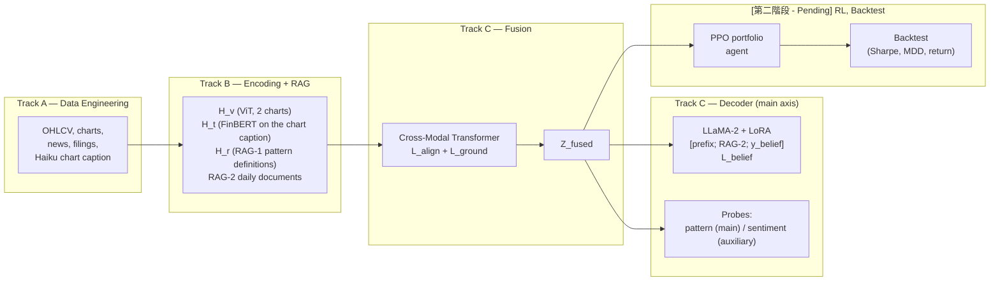

# MultiFinRL

**A Multimodal Retrieval-Augmented Financial Decision Framework with Reinforcement Learning**

MultiFinRL turns each trading day's two market charts (candlestick + volume) into a single vector, `Z_fused`, that represents a stock's market state. A shared-weight dual-image vision encoder (ViT) reads the charts (H_v); Claude Haiku writes a chart caption that FinBERT encodes (H_t); RAG-1 retrieves chart-pattern definitions (H_r); a Cross-Modal Transformer fuses them into `Z_fused`, trained with L_align and L_ground. A Decoder (LLaMA + LoRA) then takes `Z_fused` as a soft prompt plus RAG-2 snippets from that day's news, filings and transcripts, and writes a structured belief (`<TREND>`, `<RISK_LEVEL>`, narrative), trained with L_belief. In phase 2, `Z_fused` is the state input for a PPO agent that allocates a portfolio.

---

| Phase | Goal |
|---|---|
| Phase 1 | Build the data → `Z_fused` → Decoder pipeline with the three losses (L_align, L_ground, L_belief); validate `Z_fused` with a chart-pattern probe (market-sentiment classification is an auxiliary reference). |
| Phase 2 | Connect `Z_fused` to a PPO agent for portfolio allocation; run a full backtest; compare performance with and without RL (Sharpe ratio, max drawdown, etc.). |

Both phases remain in the project scope. The current automated pipeline covers Phase 1 only;
**[第二階段 - Pending]** RL and backtesting will be reconnected after the multi-asset protocol is finalized.

## System Architecture

Full interactive architecture (v2, the source of truth): [`docs/architecture/architecture.html`](docs/architecture/architecture.html) — open it in a browser. Decisions behind it: `docs/decisions.md` #108–#131 (#123–#131 record how the code implements it).



This runs once per trading day for the configured date range, producing one `Z_fused` vector per day — several thousand for a multi-year run on a single stock.

---

## Ownership and Directory Layout

| Module | Directory | Responsibility | Output |
|---|---|---|---|
| A | `module_a_data/` | Data engineering: crawlers, chart generation, text cleaning, chunking, price-movement labels | One JSON record per day (`data/processed/dataset/`) |
| B | `module_b_encoder/` | ViT / FinBERT encoding, RAG-1 pattern definitions, RAG-2 document snippets | Daily `H_v`, `H_t` vectors (`data/vectors/`), RAG-1 definition vectors, RAG-2 snippets |
| C | `module_c_fusion/` | Cross-Modal Transformer, Decoder, probes; PPO and backtesting (phase 2, pending) | `Z_fused`, the Decoder's belief text, validation reports |

Shared code (schema validation, path constants, utilities) lives in `shared/` and is jointly maintained; changes there should be flagged to the other tracks before merging.

## Repository Structure

```
MultiFinRL/
├── README.md                       # this file
├── requirements.txt                 # single source of truth for the dev environment
├── .gitignore
├── configs/
│   └── config.yaml                  # global parameters: tickers, date range, chart/label settings
├── docs/
│   ├── architecture/architecture.html  # system architecture v2; overrides the proposal where they differ
│   ├── data_format.md               # data contract between A / B / C
│   ├── decisions.md                 # decision log, including open questions
│   ├── data_and_experiments_log.md  # data sources and classification results over time
│   ├── conduct_script.md            # copy-paste command cheat sheet, A → B → C → decoder
│   ├── project_status_2026-08.md    # current status vs. the formal proposal, section by section
│   ├── decoder_finetuning_summary.md   # decoder QLoRA fine-tuning: method, LoRA scope, training setup
│   ├── spec_b_event_extraction_llm.md  # spec: LLM-based event extraction (implemented, see decisions.md #35)
│   └── reference/
│       ├── 115WFAA310699_CM03.pdf              # the formal grant proposal — source of truth
│       ├── 115WFAA310699_CM03.md               # Markdown transcription (LaTeX formulas)
│       ├── 115WFAA310699_CM03_zh.md            # Traditional Chinese translation
│       ├── images/                             # figures cropped from the PDF
│       └── README.md
├── samples/
│   ├── DataStruct.example.json      # example of A's output format
│   └── vectors_index.example.json   # example of B's output format
├── shared/
│   ├── schemas.py                   # validates records against the data contract
│   ├── paths.py                     # path constants
│   └── utils.py
├── module_a_data/                   # Track A — data engineering
│   ├── README.md
│   ├── crawler/
│   │   ├── fetch_ohlcv.py           # OHLCV via yfinance
│   │   ├── fetch_news.py            # recent news
│   │   ├── fetch_news_alpaca.py     # historical news backfill via Alpaca News API
│   │   ├── fetch_filings.py         # SEC EDGAR filings (10-K/10-Q only, no 8-K — see decisions.md #41)
│   │   ├── fetch_transcripts.py     # earnings-call transcripts via Alpha Vantage API (ALPHA_VANTAGE_API_KEY)
│   │   └── fetch_macro.py           # point-in-time FRED/FOMC data for ETF/index --macro mode
│   ├── preprocess/
│   │   ├── chart_generator.py       # mplfinance candlestick charts, 20-day window
│   │   ├── text_cleaner.py          # HTML/noise cleanup (news + filing-specific iXBRL/hidden-content stripping)
│   │   └── chunker.py               # document chunking (≤512 tokens)
│   ├── labeling.py                  # BULLISH / BEARISH / NEUTRAL label generation (quantile thresholds)
│   ├── macro_context.py             # point-in-time as-of join for indicators/news/dot plots
│   ├── chart_caption.py             # Claude Haiku reads both charts -> chart caption (answer sheet)
│   └── build_dataset.py             # assembles the daily JSON records
├── module_b_encoder/                # Track B — encoders + RAG-1/RAG-2 (+ standalone event-extraction tool)
│   ├── README.md
│   ├── encoders/
│   │   ├── vision_encoder.py        # ViT -> H_v
│   │   └── text_encoder.py          # FinBERT -> H_t
│   ├── rag/
│   │   ├── pattern_kb.py            # RAG-1: pattern definitions (data/knowledge/patterns/) -> FinBERT vectors
│   │   └── rag2.py                  # RAG-2: daily 15–20 document snippets for the Decoder context
│   ├── event_extraction.py          # keyword or --method llm; standalone data-quality check, not in the pipeline (#130)
│   ├── event_ground_truth_llm.py    # LLM-assisted ground truth labeling for event_extraction.py
│   ├── event_ground_truth_prompt.py # shared prompt used by the above and event_extraction.py --method llm
│   ├── llm_client.py                 # shared LLM-calling helpers (claude/openai/deepseek)
│   └── generate_vectors.py          # main entry point: produces H_v / H_t (caption) per day
├── module_c_fusion/                 # Track C — fusion, validation, decoder, RL, backtest, explainability
│   ├── README.md
│   ├── fusion/
│   │   ├── model.py                 # CrossModalTransformer: shared P_v/P_t/P_r, RAG-1 retrieval, α̂
│   │   ├── train.py                 # L_align + L_ground training, exports Z_fused
│   │   └── consolidate.py           # merges per-day Z_fused into one index file
│   ├── validation/
│   │   ├── classifier.py            # auxiliary reference: Z_fused -> market sentiment (3-class)
│   │   └── pattern_probe.py         # main probe: masked-H_t Z_fused -> chart pattern class
│   ├── reporting/
│   │   └── pipeline_report.py       # Phase 1 JSON -> report.md + provenance + figures
│   ├── decoder/                     # Z_fused -> structured belief narrative (proposal sec. 3.4/3.5)
│   │   ├── model.py                 # ZFusedProjector + QLoRA LLaMA-2-7b backbone (4-bit)
│   │   ├── train.py                 # QLoRA fine-tuning, L_belief loss, time-based train/val/test split, --resume
│   │   ├── evaluate.py              # held-out test loss delta, tag accuracy, optional LLM-as-judge
│   │   ├── generate_y_belief.py     # LLM-bootstrapped training target (trend from A's label, risk/narrative from LLM)
│   │   ├── y_belief_prompt.py       # prompt for generate_y_belief.py
│   │   └── judge_prompt.py          # prompt for evaluate.py's optional LLM-as-judge
│   ├── explainability/
│   │   └── integrated_gradients.py  # cross-modal attribution on the PPO policy (captum)
│   ├── rl/
│   │   ├── env.py                   # PPO environment and reward function
│   │   └── train_ppo.py             # --curriculum for volatility-staged curriculum learning
│   └── backtest/
│       └── backtest.py              # cumulative return, Sharpe ratio, max drawdown (single-ticker only)
├── experiments/                     # completed experiments are archived as reports
│   └── vision/
│       ├── visualize_comparison_report.py # backbone comparison charts
│       ├── cross_stock_report.py     # cross-stock binary charts + Markdown
│       ├── render_experiment_report.py # report.json -> charts + readable Markdown
│       └── README_cross_stock.md     # archived cross-stock design and result record
├── scripts/
│   └── run_pipeline.py              # Phase 1: A -> B -> Fusion -> pattern probe / sentiment classifier -> report (Decoder run separately)
└── data/                            # not tracked in git except data/labels/; synced locally/via cloud storage
    ├── raw/                         # Track A's raw inputs (ohlcv, charts, news, filings, transcripts)
    ├── processed/dataset/           # Track A's deliverable: one JSON per day
    ├── vectors/                     # Track B's deliverable: .npy vectors + index JSON
    ├── outputs/                     # Track C outputs; reports/{run_id}/ contains Phase 1 report bundles
    └── labels/                      # answer sheets (chart_caption, y_belief, event_ground_truth) — the one data/ subfolder tracked in git
```

## Data Flow

Full definition in `docs/data_format.md`; the handoff points are:

1. **A → B**: `data/processed/dataset/{TICKER}/{YYYY-MM-DD}.json` — one record per day, containing the chart path, a news list (with a `days_ago` field), filing/transcript chunks, and the price-movement label.
2. **B → C**: `data/vectors/{TICKER}/{YYYY-MM-DD}/` — `H_v.npy`, `H_t.npy` (chart caption), plus an `index.json` recording shapes and the caption labels; RAG-1 definitions in `data/vectors/_patterns/patterns.npz`; RAG-2 snippets in `data/outputs/rag2/`.
3. **C output**: `data/outputs/` — `Z_fused` (per day and as a consolidated index), model checkpoints, and backtest reports.

## Global Specifications

| Item | Spec |
|---|---|
| Market / initial universe | US equities. AAPL has the complete multimodal pipeline; ETF/index runs (macro mode, currently pending, #122) are supported through `run_pipeline.py --ticker SPY --macro`, replacing company documents with point-in-time FRED/FOMC context and using K-line＋FOMC SEP dot plot as the current ViT inputs. Volume remains available as an ablation. |
| Data range | 2021-01 onward, continuously extended (currently through 2026-08; see `configs/config.yaml`) |
| Charts | 20-day trailing window, PNG, 224×224, RGB |
| Price-movement label | Return from close to the close 5 trading days later; train-period 1/3 and 2/3 quantiles define BEARISH / NEUTRAL / BULLISH in strict experiments |
| Text chunking | ≤512 tokens per chunk (FinBERT's input limit) |
| RAG | RAG-1: top-K pattern definitions out of all definitions in `data/knowledge/patterns/` (K and the class set are still being tuned; see `configs/config.yaml`), into fusion; RAG-2: 15–20 date-filtered snippets, into the Decoder context |
| Missing daily news | backfilled from prior days, with a `days_ago` field so the model can weigh relevance |
| Fine-tuning | Fusion model (`fusion/train.py`): full-parameter training. Decoder (`decoder/train.py`): QLoRA (4-bit, LoRA on all attention+MLP linear layers). ViT: LoRA r4 improved mean validation macro F1 over five seeds (0.3662 vs 0.3328) but won only 3/5 seeds, so Frozen remains the formal encoder pending broader cross-stock/time validation. |
| Dev environment | `requirements.txt` in this repo is the single source of truth |

## Current Status and Roadmap

Operational today, on AAPL:

- Data (A): OHLCV, charts, recent news, and historical news (via the Alpaca News API, 2021–2026) are all in place. Filings, including 8-K, are fetched via the SEC EDGAR official API (`fetch_filings.py`; an alternate `edgartools`-based fetcher was evaluated as a candidate but never actually produced any data and has been removed, `docs/decisions.md` #31, #41). Earnings-call transcripts switched from an unreliable third-party scraper (`foolcalls`, never completed an end-to-end run, removed) to the official Alpha Vantage API (`fetch_transcripts.py`, needs `ALPHA_VANTAGE_API_KEY`).
- Chart caption (A): Claude Haiku reads both charts and returns a pattern class, a formula-decided volume label (Haiku is only told the volume situation, never multiples or thresholds), and three caption sections (`module_a_data/chart_caption.py`, `data/labels/chart_caption/AAPL.json`, 1,381 days). The class set and window length are still under experiment (`docs/data_and_experiments_log.md`).
- Encoding (B): frozen ViT gives H_v; frozen FinBERT encodes the composed caption as H_t; `rag/pattern_kb.py` encodes the pattern definitions for RAG-1; `rag/rag2.py` pre-selects the Decoder's daily snippets. The old FAISS news retrieval and the H_t-from-news encoding were removed in v2 (#108–#131). Event extraction (`event_extraction.py`) is kept only as a standalone data-quality tool, outside the pipeline (#130).
- Fusion and validation (C): the Cross-Modal Transformer is trained with L_align (in-batch image↔caption contrastive) and L_ground (KL between the caption-pattern target α* and the fusion attention α̂, #131). The main probe reads chart patterns from the masked-H_t `Z_fused` (`validation/pattern_probe.py`); the 3-class sentiment classifier is an auxiliary reference. Latest AAPL numbers are in `docs/data_and_experiments_log.md`.
- **[第二階段 - Pending] RL and backtesting:** the existing single-ticker PPO, Integrated Gradients, and buy-and-hold / rule-based / PPO backtest modules and historical results are retained, but they are no longer executed by `scripts/run_pipeline.py`. They will be reconnected after the multi-asset state/action/reward and evaluation protocol are finalized.
- Reporting: every successful Phase 1 pipeline run writes `data/outputs/reports/{YYYYMMDD_HHMMSS}/report.md`, a frozen `report.json`, source JSON snapshots, and figures. The directory name is only the run ID; ticker and mode are recorded inside the report. Source run IDs, split counts, manifest paths, and Fusion checkpoint hashes must agree before a report is emitted.
- Decoder (C, `module_c_fusion/decoder/`): `Z_fused` becomes a soft-prompt prefix into a 4-bit LLaMA-2-7b with LoRA, followed by RAG-2 snippets and the target `y_belief`; L_belief also trains the fusion layer jointly. `--no_rag2` runs on a Mac. The old decoder checkpoints were trained against the pre-v2 fusion layer and have been deleted; the decoder has not been retrained on v2 yet. `y_belief` (trend from A's label, risk level and narrative from an LLM) currently covers 1,223 of 1,381 AAPL days and was generated with DeepSeek.
- A domain-gap comparison for ViT on candlestick charts vs. its natural-image pretraining has been run: removing the candlestick chart drops macro F1 by 51%, showing the current (non-domain-pretrained) ViT still contributes substantially (`docs/decisions.md` #46).

Known gaps, tracked in `docs/decisions.md`:

- The vision encoder itself is not domain-pretrained on financial charts as the proposal specifies (still generic ImageNet ViT) — a known gap, though the domain-gap experiment above shows it's not dead weight, which lowers the urgency of replacing it.
- Multi-asset portfolio backtesting — the current backtest and RL environment allocate between a single stock and cash, not across multiple tickers. Not started.
- Whether "technical indicators" (RSI/MACD-style) should be a second chart merged into `H_v` — confirmed in scope by the project lead but not yet implemented, non-urgent (`docs/decisions.md` #64).
- The fusion layer does not yet beat frozen ViT on the pattern probe; RAG-1 hit@1 is about 0.32.

## Getting Started

```bash
git clone <repo-url>
cd MultiFinRL
python -m venv .venv && source .venv/bin/activate   # Windows: .venv\Scripts\activate
pip install -r requirements.txt
```

See each module's own `README.md` for how to run it.

## Execution Order

**Phase 1 (parallel)**
- A starts pulling data, delivering an initial 50–100 sample days early.
- B wires up ViT / FinBERT / RAG against synthetic data first — one image or chunk in, one correctly formatted vector out.
- C wires up the Fusion Transformer against synthetic vectors — three vectors in, `Z_fused` out.

**[第二階段 - Pending] Phase 2 (once the multi-asset protocol is finalized)**
- A keeps extending coverage.
- C reconnects multi-asset RL and backtesting to the automated pipeline.

## Collaboration Guidelines

- `main` stays runnable; work happens on `feat/a-*`, `feat/b-*`, `feat/c-*` branches, merged via PR.
- Data (`data/`) is not committed to git and is synced separately; the repo holds only code and format examples.
- Any change to the **data format** must update `docs/data_format.md` and `shared/schemas.py` first, and be flagged to the other tracks before downstream code changes.
