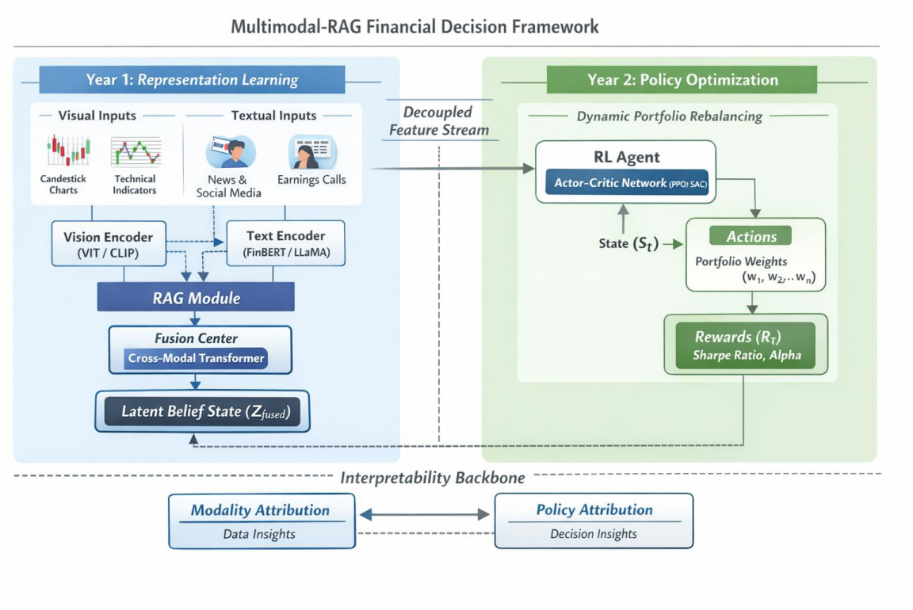

# 115WFAA310699 研究計畫書（CM03）— Markdown 轉錄版

> **轉錄說明**
> - 來源：[115WFAA310699_CM03.pdf](115WFAA310699_CM03.pdf)（共 24 頁）。本檔為逐字轉錄，內容以 PDF 為準。
> - 公式改寫為 LaTeX；圖片以截圖存於 [images/](images/)；表格改成 Markdown 表格。
> - `<!-- p.N -->` 標記原始 PDF 頁碼：標記之後的內容屬於第 N 頁。標記一律放在段落（或整個清單）結束後，跨頁的段落不拆開，整段歸在標記前。
> - 原文中的筆誤／排版殘留**保留原樣**，並以「〔轉錄註〕」標示，彙整於文末〈轉錄註記〉。

---

<!-- p.1 -->
## 三、研究計畫內容（以中文或英文撰寫）

### (一) 研究計畫之背景

> 請詳述本研究計畫所要探討或解決的問題、研究原創性、重要性、預期影響性及國內外有關本計畫之研究情況、重要參考文獻之評述等。如為連續性計畫應說明上年度研究進度。

### 1. Introduction

Financial markets generate vast amounts of heterogeneous and dynamically evolving information. Market participants must continuously process textual news reports, analyst commentaries, earnings call transcripts, structured financial statements, numerical time-series data, and visual technical charts. The integration of these diverse modalities is essential for forming coherent market interpretations and making informed investment decisions. However, existing financial artificial intelligence (AI) systems remain largely fragmented, focusing on isolated modalities rather than holistic market understanding.

Recent advances in multimodal large language models (MLLMs) [1] have demonstrated remarkable capabilities in integrating textual and visual inputs within unified representation spaces. (e.g. GPT-5.2 [2]) These models can synthesize cross-modal signals and generate context-aware interpretations, making them promising tools for financial analytics. In parallel, retrieval-augmented generation (RAG) [3] techniques have been proposed to enhance factual grounding by dynamically incorporating external knowledge sources such as regulatory filings, macroeconomic reports, and historical disclosures. While these developments significantly improve multimodal information synthesis, most applications in finance remain limited to descriptive tasks such as document summarization, sentiment extraction, and question answering

A fundamental gap persists between multimodal understanding and sequential financial decision-making. Financial markets are inherently dynamic systems in which decisions must be made under uncertainty, and actions influence subsequent states and reward distributions. Traditional financial AI approaches have addressed specific components of this process. Text-based models such as FinBERT [4] and FinancialBERT [5] have been applied to news and earnings calls for sentiment analysis. Time-series models, including LSTMs [6-8] and Transformer-based architectures, have been used for price forecasting. Vision-based models such as CNNs and Vision Transformers (ViTs) [9-10] have been adopted for technical chart recognition. Reinforcement learning (RL) methods [11-14] have also been explored for algorithmic trading and portfolio allocation. However, these approaches are typically developed in isolation, lacking a unified architecture that integrates multimodal perception with principled decision optimization.

<!-- p.2 -->

This study proposes a decision-centric financial AI framework that bridges multimodal market understanding and sequential policy learning. Specifically, we conceptualize multimodal large language models and retrieval-augmented mechanisms as **market belief constructors**. These components synthesize heterogeneous financial signals into structured latent representations that capture the semantic and contextual state of the market. Building upon these belief states, a reinforcement learning agent learns optimal, risk-sensitive policies for portfolio allocation and financial decision-making. By placing RL at the core of the framework, the system moves beyond descriptive analytics toward actionable and adaptive decision support.

In addition to decision optimization, transparency and accountability are critical requirements in financial applications. Unlike consumer-oriented AI systems, financial decision models operate in high-stakes environments where prediction errors may lead to substantial losses or systemic risks. Consequently, interpretability must extend beyond token-level attention maps to encompass decision-level attribution. This research integrates cross-modal attribution analysis to identify how textual signals, visual patterns, and retrieved evidence contribute to policy outputs. Such interpretability mechanisms aim to support regulatory compliance, risk auditing, and institutional trust.

The proposed framework therefore advances financial AI along three interconnected dimensions:

1. multimodal belief construction through integrated perception and retrieval,
2. sequential decision optimization via reinforcement learning over belief states, and
3. cross-modal interpretability at both representation and policy levels.

By unifying perception, reasoning, and decision within a coherent architecture, this study seeks to establish a foundation for next-generation financial decision systems that are risk-aware, interpretable, and deployable in real-world markets. Beyond investment applications, the framework holds potential implications for regulatory technology (RegTech), systemic risk monitoring, and financial inclusion by enabling more transparent and reliable AI-driven financial analysis.

### 2. Literature Review

Deep learning has been widely adopted in financial forecasting, particularly for modeling nonlinear temporal dependencies in stock prices and market indicators. Recurrent neural networks (RNNs), especially Long Short-Term Memory (LSTM) networks, have become a standard approach for capturing sequential patterns in financial time series. LSTM-based architectures have demonstrated superior performance over traditional statistical models by effectively modeling long-term dependencies and nonlinear dynamics in stock price movements [15], [16].

<!-- p.3 -->

Several studies have further integrated convolutional neural networks (CNNs) with LSTM models to enhance predictive performance. In these hybrid architectures, CNN layers are employed to extract local spatial features from price matrices or technical indicators, while LSTM layers capture temporal evolution [17], [18]. Empirical evidence suggests that CNN–LSTM and CNN–BiLSTM models often outperform standalone LSTM or CNN models in stock price prediction and volatility forecasting tasks [19]. These approaches highlight the importance of combining spatial feature extraction with temporal modeling in financial forecasting.

However, despite their predictive effectiveness, most LSTM- and CNN-based financial models rely primarily on numerical price data and technical indicators, neglecting textual and contextual information that may significantly influence market behavior.

#### 2.1 Transformer-Based and Vision-Based Models in Finance

With the emergence of Transformer architectures, attention mechanisms have increasingly been applied to financial time-series analysis. Transformer-based models offer advantages in modeling long-range dependencies without recurrence, making them suitable for capturing complex financial dynamics [20], [21].

In parallel, Vision Transformer (ViT) architectures have been explored in financial contexts, particularly for processing chart-based representations of time series. By converting price sequences into image-like representations, ViT models can capture global structural patterns in technical charts [22]. Hybrid architectures combining CNNs with Transformer modules have also been proposed, leveraging CNNs for local feature extraction and Transformers for global context modeling in stock prediction tasks [23].

While these approaches improve representation learning, they largely remain within single-modality frameworks—either numerical sequences or visual chart representations. The integration of heterogeneous modalities, including textual reports, analyst commentary, and structured financial documents, remains limited.

#### 2.2 Reinforcement Learning in Financial Decision-Making

Beyond prediction, reinforcement learning (RL) has been extensively investigated for financial decision-making tasks, including portfolio allocation, trading strategy optimization, and risk management. Early work applied Deep Q-Networks (DQN) and policy gradient methods to learn trading strategies directly from historical price sequences [24]. Subsequent research introduced actor–critic frameworks such as Proximal Policy Optimization (PPO) and Asynchronous Advantage Actor–Critic (A3C), demonstrating improved stability and performance in dynamic portfolio management [25], [26].

<!-- p.4 -->

More advanced models have incorporated graph neural networks within RL frameworks to model inter-asset correlations and improve diversification strategies [27]. These RL-based approaches move beyond static prediction toward adaptive decision optimization under uncertainty.

Nevertheless, existing financial RL models typically define the state space using historical prices and technical indicators alone. They rarely incorporate multimodal contextual information such as earnings reports, macroeconomic signals, regulatory disclosures, or visual chart structures. As a result, the learned policies may fail to fully reflect the semantic and structural complexity of real-world financial markets.

#### 2.3 Large Language Models in Finance

The rapid advancement of large language models (LLMs) has significantly reshaped research in financial natural language processing. Domain-adapted models such as FinBERT [4] and FinancialBERT [5] have been widely applied to sentiment analysis of financial news, earnings call transcripts, and event-driven market interpretation tasks. These models demonstrate improved performance over general-purpose language models by incorporating financial-specific corpora and domain vocabulary.

More recently, large-scale foundation models trained on financial data, such as BloombergGPT [28] and FinGPT [29], have further extended the application scope of LLMs in finance. These models support tasks including document summarization, financial question answering, event extraction, and regulatory document interpretation. Their performance indicates that domain adaptation at scale can substantially enhance contextual understanding and factual consistency in financial texts.

In parallel, retrieval-augmented generation (RAG) frameworks have been introduced to mitigate hallucination and improve factual grounding in LLM-based systems [30]. By dynamically retrieving external financial documents—such as 10-K filings, macroeconomic reports, or policy announcements—RAG-based models improve reliability and contextual completeness. Recent multimodal RAG systems tailored to financial question answering further demonstrate the feasibility of integrating structured tables, textual disclosures, and visual information into unified answer-generation pipelines [31], [32].

Despite these advances, the majority of LLM-based financial applications remain focused on descriptive and analytical tasks. Current systems are primarily designed for summarization, information retrieval, and text-based reasoning rather than sequential financial decision-making. In other words, LLMs in finance have largely functioned as advanced information processors rather than decision policy optimizers.

<!-- p.5 -->

Furthermore, LLM-based systems are typically developed independently from reinforcement learning frameworks used for portfolio management and trading strategy optimization [33]. As a result, multimodal financial understanding and decision policy learning are treated as separate research directions, lacking a unified architecture that integrates semantic belief construction with sequential optimization.

These limitations suggest that the next stage of financial AI development lies not merely in improving language understanding or multimodal reasoning accuracy, but in transforming LLM-derived multimodal representations into structured belief states that can support risk-sensitive decision optimization.

#### 2.4 Research Gap

The existing body of literature reveals substantial progress across multiple research streams in financial artificial intelligence. Deep learning models such as LSTM-, CNN-, and Transformer-based architectures have improved predictive performance in financial time-series modeling. Vision-based models, including CNN and Vision Transformer (ViT) frameworks, have demonstrated effectiveness in extracting structural information from technical charts. Reinforcement learning methods have enabled adaptive portfolio management and trading strategy optimization. Meanwhile, large language models and retrieval-augmented systems have enhanced financial text understanding and document-level reasoning. Despite these advancements, a structural fragmentation persists.

First, multimodal financial representation learning and sequential decision optimization are largely developed in isolation. MLLM-based systems focus primarily on information synthesis, summarization, and question answering, whereas reinforcement learning frameworks concentrate on action optimization using low-dimensional numerical states such as historical prices and technical indicators. The absence of a principled mechanism for transforming multimodal semantic representations into structured decision states limits the integration of perception and policy learning.

Second, existing financial RL models typically define the state space using numerical time-series features, neglecting rich contextual signals embedded in textual disclosures, earnings reports, regulatory filings, and visual chart structures. As a result, policy learning is often decoupled from higher-level semantic understanding, potentially leading to suboptimal or context-insensitive strategies.

Third, interpretability research in financial AI remains modality-specific. While token-level attribution methods and Grad-CAM visualizations provide local explanations, they do not extend naturally to policy-level decision attribution in sequential settings. The interpretability of reinforcement learning policies under heterogeneous multimodal inputs remains underexplored.

<!-- p.6 -->

Taken together, these observations indicate a critical gap:

> **There is currently no unified financial AI framework that integrates multimodal belief construction, risk-sensitive reinforcement learning, and cross-modal decision-level interpretability within a coherent sequential decision architecture.**

Addressing this gap requires reconceptualizing multimodal large language models not as end-task predictors, but as belief constructors that generate semantically enriched state representations. These belief states must then be connected to reinforcement learning agents capable of optimizing policies under uncertainty and risk constraints. Furthermore, decision-level attribution mechanisms are necessary to ensure transparency and regulatory compatibility in high-stakes financial environments.

The proposed research aims to fill this gap by developing a decision-centric multimodal financial framework in which multimodal perception, retrieval grounding, policy optimization, and interpretability are integrated into a unified architecture.

#### 2.5 Proposed Framework and Contributions

To address the aforementioned research gap, this study proposes a decision-centric financial AI architecture, termed: "**A Multimodal Retrieval-Augmented Financial Decision Framework with Reinforcement Learning.**"

The core innovation of the proposed framework lies in the integration of multimodal belief construction, sequential policy optimization, and cross-modal interpretability within a unified system.

First, multimodal large language models (MLLMs) and retrieval-augmented generation mechanisms are conceptualized as market belief constructors. Rather than serving as end-task predictors, these components synthesize heterogeneous financial signals—including textual disclosures, technical charts, numerical indicators, and retrieved external documents—into structured latent representations. These belief states encode semantically enriched market conditions and provide a high-dimensional yet interpretable representation of financial environments.

Second, reinforcement learning (RL) is introduced as the decision optimization layer. Operating over multimodal belief states, the RL agent learns risk-sensitive policies for portfolio allocation and sequential financial decision-making. This design bridges perception and action, enabling adaptive strategies under uncertainty rather than static analytical outputs.

Third, the framework incorporates cross-modal interpretability mechanisms at both representation and policy levels. In addition to token-level and visual attributions, decision-level attribution techniques are employed to quantify how multimodal inputs influence policy outputs. This ensures transparency, accountability, and regulatory compatibility in high-stakes financial contexts.

<!-- p.7 -->

By integrating multimodal perception, retrieval grounding, reinforcement learning, and decision-level interpretability, the proposed framework advances financial AI from isolated analytical modules toward coherent, decision-oriented systems capable of operating in dynamic market environments.

---

### (二) 研究方法、進行步驟及執行進度

> 請分年列述：1.本計畫採用之研究方法與原因及其創新性。2.預計可能遭遇之困難及解決途徑。3.重要儀器之配合使用情形。4.如為須赴國外或大陸地區研究，請詳述其必要性以及預期效益等。

### 3. Research Methodology

#### First-Year

This study proposes a multi-level composite architecture designed to transform heterogeneous financial data into Latent Belief State for downstream decision-making. Diverging from conventional MLLM applications focused on descriptive Visual Question Answering (VQA), the first year of this project emphasizes the construction of a decision-centric state representation. To achieve this, we utilize distinct encoders for visual inputs (e.g., candlestick charts, technical indicators, and financial statements) and textual inputs (e.g., news, analyst reports, and corporate filings). These signals are projected into a unified hidden space to form a coherent market context. Furthermore, a Retrieval-Augmented Generation (RAG) module is integrated to incorporate external factual evidence from SEC filings and macroeconomic datasets, mitigating the risk of model hallucinations. The primary objective of this stage is to generate a compressed, semantically rich feature vector, denoted as $Z_{fused}$, which serves as the environment state input for the Reinforcement Learning (RL) agent in Year 2. The primary architectural framework is illustrated in Figure 1. Phase 1 focuses on perception and belief construction, generating a decoupled latent state ($Z_{fused}$). Phase 2 utilizes this state for RL-based policy optimization with a unified interpretability layer

<!-- p.8 -->

**Figure 1. The proposed two-phase, decision-centric multimodal financial framework.**

> **〔轉錄註：Figure 1 圖內文字整理〕** 標題「Multimodal-RAG Financial Decision Framework」。
> - **左側 Year 1: Representation Learning**：Visual Inputs（Candlestick Charts、Technical Indicators）→ Vision Encoder (ViT / CLIP)；Textual Inputs（News & Social Media、Earnings Calls）→ Text Encoder (FinBERT / LLaMA)。兩個 encoder（含虛線交叉連線）→ **RAG Module** → **Fusion Center (Cross-Modal Transformer)** → **Latent Belief State ($Z_{fused}$)**。
> - **中間**：「Decoupled Feature Stream」箭頭，從 Year 1 指向 Year 2 的 RL Agent。
> - **右側 Year 2: Policy Optimization**（Dynamic Portfolio Rebalancing）：State ($S_t$) → **RL Agent**（Actor-Critic Network (PPO/SAC)）→ **Actions**（Portfolio Weights $(w_1, w_2, \dots, w_n)$）→ **Rewards ($R_T$)**（Sharpe Ratio, Alpha）；Rewards 以虛線回饋到左側 Latent Belief State 底部。
> - **底部 Interpretability Backbone**：Modality Attribution（Data Insights）⟷ Policy Attribution（Decision Insights）。

Initially, the training data are organized into tuples $(X_v, X_t, D, y)$ (see Table 1), where $X_v$ denotes chart or tabular images, $X_t$ is financial text queries, $D$ is the retrieval corpus, and $y$ is the target outputs. Each sample is designed to support both multimodal representation learning and retrieval-augmented generation. For instance, an example input image could be a candlestick chart file located at `images/AAPL_Q1_2021.png`, described as *"Daily candlestick chart of Apple Inc. showing a head-and-shoulders formation with declining volume, indicative of a potential bearish reversal."*

**Table 1. Data Organization for Multimodal Belief Construction (Year 1)**

| Category | Content |
|---|---|
| **Image Data** ($X_v$) | **File Path:** images/AAPL_Q1_2021.png **Description:** Daily candlestick chart of Apple Inc. showing a "head-and-shoulders" pattern with declining trading volume. |
| **Feature Extraction Target** | Identify key technical patterns, calculate visual signal confidence levels, and extract trend reversal probabilities. |
| **Retrieved Context** ($D$) | 1. **Technical Definition:** A head-and-shoulders formation combined with decreasing volume is a strong bearish reversal indicator. 2. **External Linkage:** S&P 500 index faced resistance during the same period, suggesting systemic pressure. |
| **Belief Representation Output** ($Z_{fused}$) | **[Structured Output]:** ● **Market Sentiment:** Bearish ● **Key Indicators:** Volume-price divergence, Pattern reversal ● **Evidence Alignment:** SEC 10-Q report highlights supply chain constraints. *(This output is formatted as a latent vector for RL policy optimization in Year 2.)* |

<!-- p.9 -->
#### 3.1 Vision encoder

The image data $X_v \in \mathbb{R}^{H \times W \times C}$ (with height $H$, width $W$, and channels $C$; e.g., $C = 3$ for color candlestick charts, $C = 1$ or grayscale scanned tables) are divided into $T_v$ non-overlapping patches, each of size $p \times p$. These patches are flattened and embedded, then passed through a vision encoder $g(\cdot)$ (e.g., CLIP or ViT pretrained on financial chart corpora), producing token-level features:

$$
Z_v = g(X_v) \in \mathbb{R}^{T_v \times d_v}
$$

Here, $T_v = \frac{HW}{P^2}$ is the number of visual tokens and $d_v$ is the vision feature dimension.

To align these vision features with the hidden space of the language model, we apply a learned projection matrix $P_v \in \mathbb{R}^{T_v \times d_h}$ 〔轉錄註 1〕. The projected features are:

$$
H_v = LN(Z_v P_v) \in \mathbb{R}^{T_v \times d_h}
$$

where LN denotes Layer Normalization, a standard operation used to stabilize training by re-centering and re-scaling each feature vector.

In subsequent fusion stages, these projected tokens $H_v$ are treated analogously to word embeddings. If a single global representation of the entire image is required, we employ a pooling operator, such as:

<!-- p.10 -->
- [CLS] token pooling: appending a special "classification token" that aggregates global context; or
- mean pooling: averaging all token embeddings.

This pooled embedding is denoted as

$$
h_v = pool(H_v) \in \mathbb{R}^{d_h},
$$

and can serve as a compact summary vector for tasks like retrieval key generation or global conditioning in the decoder.

#### 3.2 Text encoder

In parallel with visual encoding, each financial text query $X_t$ (e.g., "What trading signal is indicated by this candlestick chart?" or "Summarize the key risks in Tesla's Q2 earnings report") is tokenized into a sequence of $T_t$ tokens:

$$
X_t = w_1, w_2, \dots, 2_{T_t}.
$$

〔轉錄註 2〕

Each token $w_i$ is mapped into an embedding vector through a pre-trained financial language model encoder $f(\cdot)$, such as FinBERT, FinancialBERT, or a domain-adapted LLaMA/BLOOM model. The encoded representations are:

$$
Z_t = f(X_t) \in \mathbb{R}^{T_t \times d_t}
$$

where $d_t$ is the text encoder's hidden dimension.

To ensure consistency with the multimodal fusion stage, these embeddings are projected into the same hidden space dimension $d_h$ used by the language model. This is achieved by a projection matrix $P_t \in \mathbb{R}^{d_t \times d_h}$:

$$
H_t = LN(Z_t P_t) \in \mathbb{R}^{T_t \times d_h},
$$

where $LN$ again denotes Layer Normalization.

Analogous to the visual pathway, if a global representation of the text sequence is required (e.g., for retrieval keys), a pooling operation is applied:

$$
h_t = pool(H_t) \in \mathbb{R}^{d_h}.
$$

Here, the pooling operator can be the hidden state of the [CLS] token, which is standard in BERT-based models, or mean pooling across all tokens. The choice depends on whether the downstream task benefits more from a semantically focused ([CLS]) or evenly distributed (mean) representation.

<!-- p.11 -->

#### 3.3 Retrieval-Augmented Generation

To incorporate external domain-specific knowledge, we employ a retrieval-augmented generation (RAG) module. The retrieval corpus denotes as $D = d_1, d_2, \dots, d_{|D|}$ consists of heterogeneous financial documents, such as SEC filings, analyst reports, news articles, and macroeconomic bulletins.

Given a multimodal input pair $(H_v, H_t)$, we construct a query embedding $q \in \mathbb{R}^{d_h}$ by pooling the fused visual and textual representations:

$$
q = pool([h_v; h_t]),
$$

where $[h_v; h_t]$ denotes the concatenation of pooled visual and text embeddings, and $pool(\cdot)$ could be a linear projection or attentive pooling mechanism.

Each document $d_j \in D$ is pre-encoded into a dense vector representation $k_j \in \mathbb{R}^{d_h}$ using the same text encoder $f(\cdot)$ followed by projection $P_t$. Retrieval is then performed via similarity search in the embedding space:

$$
s_j = sim(q, k_j),
$$

where $sim(\cdot,\cdot)$ is typically cosine similarity or dot-product.

The top-$K$ documents are selected based on similarity scores:

$$
D_K = d_{j_1}, d_{j_2}, \dots, d_{j_K}, \quad j_l = \arg\max_{j} S_j.
$$

〔轉錄註 3〕

The retrieved documents are re-encoded into token embeddings $H_r \in \mathbb{R}^{T_r \times d_h}$ and concatenated with the original inputs:

$$
\widetilde{H} = [H_t; H_v; H_r],
$$

which serves as the input to the decoder for generation.

This retrieval mechanism ensures that the model can ground its predictions in factual, domain-specific financial knowledge, reducing hallucinations and improving interpretability in tasks such as earnings-call summarization, market forecasting, and risk assessment.

#### 3.4 Cross-Modal Fusion and Decoder

<!-- p.12 -->
After obtaining modality-specific embeddings for vision $H_v$, text $H_t$, and retrieved knowledge $H_r$, the model performs **cross-modal fusion** to integrate heterogeneous financial signals into a unified representation.

We first concatenate all token sequences along the temporal axis:

$$
H_{all} = [H_t; H_v; H_r] \in \mathbb{R}^{(T_t + T_v + T_r) \times d_h},
$$

where $[\,;\,]$ denotes sequence concatenation.

This sequence is then passed into a **transformer-based fusion module** $F(\cdot)$, parameterized by multi-head self-attention layers:

$$
Z_{fused} = F([H_t; H_v; H_r]) \in \mathbb{R}^{(T_t + T_v + T_r) \times d_h},
$$

Each attention head computes pairwise dependencies across modalities:

$$
Attention(Q, K, V) = softmax\left(\frac{QK^\top}{\sqrt{d_k}}\right) V,
$$

where $Q = H_{all} W_Q,\ K = H_{all} W_k,\ V = H_{all} W_v$, and $W_Q, W_k, W_v \subset \mathbb{R}^{d_h \times d_h}$ 〔轉錄註 4〕 are learned projection matrices.

The resulting fused representation $Z_{fused}$ captures dependencies such as:

- correlations between chart patterns ($H_v$) and narrative explanations in earnings reports ($H_t$)
- alignment between retrieved background documents ($H_r$) and current market news.

Finally, the **decoder** $D(\cdot)$, instantiated as a causal language model (e.g., LLaVA or a domain-adapted LLaMA-2), autoregressively generates outputs $Y = y_1, y_2, \dots, y_T$, conditioned on the fused representation:

$$
p(Y \mid H_t, H_v, H_r) = \prod_{i=1}^{T} p\left(y_i \mid y_{<i}, Z_{fused}\right)
$$

This generative process allows the system to produce **context-aware financial narratives**, such as:

- event-driven price forecasts ("Given this candlestick pattern and news sentiment, the model predicts a likely short-term downturn"),
- risk assessments ("The retrieved SEC filing highlights liquidity constraints that increase credit risk"), or
- decision support outputs tailored for institutional and retail investors.

<!-- p.13 -->

#### 3.5 Training Process and Belief State Optimization

The training of the proposed architecture in Year 1 focuses on optimizing the model's ability to synthesize multimodal signals into a reliable Latent Belief State ($Z_{fused}$). To ensure computational efficiency on a single high-performance workstation (e.g., RTX 5090), we employ Parameter-Efficient Fine-Tuning (PEFT) via QLoRA, updating only the projection layers and specific attention adapters while freezing the backbone MLLM. Each training sample consists of a tuple:

$$
\left(x_v, x_t, D_r, y_{belief}\right),
$$

where $x_v$, denotes chart or tabular images, $x_t$ denotes textual queries (e.g., market news, analyst commentary), $D_r = d_1, \dots, d_K$ represent the top-$K$ retrieved documents, and $y$ is the ground-truth target sequence (e.g., forecast explanation or structured report).

##### (1) Multimodal Alignment Loss ($L_{align}$)

For each modality, embeddings are projected into the shared space of the decoder. To ensure consistency across modalities, we impose a contrastive alignment loss between image embeddings $H_v$ and their paired text embeddings $H_t$:

$$
L_{align} = -\log \frac{\exp\left(\langle H_v H_t \rangle / \tau\right)}{\sum_{t'} \exp\left(\langle H_v H_{t'} \rangle / \tau\right)}
$$

where $\tau$ is a temperature parameter. This objective ensures that the Latent Belief State accurately reflects the correlation between technical chart formations and financial news.

##### (2) Evidence Grounding Loss ($L_{ground}$)

To prevent the model from ignoring the RAG-retrieved documents or hallucinating, we impose a grounding loss. This is based on the KL divergence between the model's cross-attention weights $\hat{\alpha}$ and the oracle relevance scores $\alpha^*$ of the retrieved passages:

<!-- p.14 -->
$$
L_{ground} = \sum_{i=1}^{K} \alpha_i^* \log \frac{\alpha_i^*}{\hat{\alpha}_i}.
$$

This ensures that the model allocates higher attribution to truly relevant financial documents.

##### (3) Belief Consistency Loss ($L_{belief}$)

To ensure that the latent representation $Z_{fused}$ captures not only linguistic syntax but also discriminative financial features required for decision-making, we define the ground-truth target $y_{belief}$ as a composite sequence containing both structured state tokens (e.g., `[BULLISH]`, `[HIGH_VOLATILITY]`) and narrative explanations.

$$
L_{belief} = -\sum_{t=1}^{T_y} \log p_\theta\left(y_{belief,t} \mid y_{belief<t}, Z_{fused}\right)
$$

where:

- $y_{belief}$ includes special classification tokens (e.g., `<TREND>`, `<RISK_LEVEL>`) inserted at the beginning of the sequence.
- $T_y$ is the length of the target sequence.

Significance: By forcing the model to predict structured indicators alongside the text, this objective compels the latent state $Z_{fused}$ to encode high-level semantic concepts (e.g., identifying a "reversal pattern" from the chart) rather than merely memorizing surface-level text statistics. This ensures that $Z_{fused}$ serves as a robust and informative state space for the RL agent in Phase 2.

##### (4) Composite Objective for Phase 1

The final joint loss for the first year is formulated as:

$$
L = \lambda_1 L_{align} + \lambda_2 L_{ground} + \lambda_3 L_{belief},
$$

Where $\lambda_3$ is prioritized to ensure the richness of the belief state, while $\lambda_1$, and $\lambda_2$ serve as structural constraints to align multimodal and retrieved signals.

#### Second-Year

#### 3.6 RL-based Policy Optimization and Unified Interpretability

In the second year, the research focus shifts from multimodal perception to **strategic decision optimization**. We utilize the **Latent Belief State (\$\$)** 〔轉錄註 5〕 generated in Phase 1 as the environmental state for training a Reinforcement Learning (RL) agent. This phase aims to develop a policy that is not only profitable but also risk-aware and interpretable.

<!-- p.15 -->

##### (1) MDP Formulation for Portfolio Management

We model the dynamic portfolio management problem as a Markov Decision Process (MDP), defined by the tuple $(\mathcal{S}, \mathcal{A}, \mathcal{P}, \mathcal{R}, \gamma)$:

- **State Space ($\mathcal{S}$):** The state at time $t$ is defined as $s_t = [Z_{fused,t}, h_{t-1}]$, where $Z_{fused,t}$ is the latent belief vector extracted from the MLLM in Phase 1, and $h_{t-1}$ represents the agent's current portfolio holdings. This decoupled design allows the RL agent to leverage high-level semantic insights without the computational burden of processing raw multimodal data directly.
- **Action Space ($\mathcal{A}$):** The action $a_t \in \mathbb{R}^N$ corresponds to the target portfolio weight vector for $N$ assets, subject to the constraint $\sum_{i=1}^{N} |a_{i,t}| = 1$ (assuming a fully invested portfolio with potential for short selling, if permitted).
- **Transition Dynamics ($\mathcal{P}$):** The environment evolves according to real market data dynamics, $s_{t+1} \sim \mathcal{P}(s_{t+1} \mid s_t, a_t)$.

〔轉錄註 6〕

##### (2) Policy Optimization via Proximal Policy Optimization (PPO)

To ensure stable convergence in the noisy financial environment, we employ the **Proximal Policy Optimization (PPO)** algorithm. PPO optimizes a clipped surrogate objective function to prevent destructive policy updates:

$$
\mathcal{L}_{CLIP}(\theta) = \hat{\mathbb{E}}_t\left[\min\left(r_t(\theta)\hat{A}_t,\ \text{clip}\left(r_t(\theta), 1-\epsilon, 1+\epsilon\right)\hat{A}_t\right)\right]
$$

where:

- $\theta$ denotes the policy parameters.
- $r_t(\theta) = \dfrac{\pi_\theta(a_t \mid s_t)}{\pi_{\theta_{old}}(a_t \mid s_t)}$ is the probability ratio between the new and old policies.
- $\hat{A}_t$ is the estimated advantage function.
- $\epsilon$ is a hyperparameter that bounds the update step size.

##### (3) Risk-Sensitive Reward Shaping ($\mathcal{R}$)

Unlike standard RL applications that maximize raw cumulative returns, financial decision-making requires strict risk control. We propose a composite **Risk-Sensitive Reward Function**:

<!-- p.16 -->
$$
\mathcal{R}_t = \mu(R_p) - \lambda_1 \cdot \sigma(R_p) - \lambda_2 \cdot \mathrm{MDD}_t - \eta \cdot \mathrm{TC}_t
$$

where:

- $\mu(R_p)$ and $\sigma(R_p)$ represent the expected return and volatility of the portfolio, respectively.
- $\mathrm{MDD}_t$ (**Maximum Drawdown**): Penalizes strategies that incur unacceptable losses from peak equity.
- $\mathrm{TC}_t$ (**Transaction Costs**): Accounts for trading friction to prevent the agent from excessive churning (over-trading).

##### (4) Unified Explainability: Integrated Gradients for Policy

〔轉錄註 7〕

To attribute the RL agent's decisions back to the original multimodal inputs, we implement **Integrated Gradients (IG)**. This method satisfies the axiom of completeness, ensuring that the attribution scores sum up to the difference in the model output relative to a baseline. The attribution for the $i$-th feature of the input $x$ (i.e., components of $Z_{fused}$) is calculated as:

$$
\text{Attribution}_i(x) = (x_i - x_i') \times \int_{\alpha=0}^{1} \frac{\partial \pi\left(a_t \mid x' + \alpha(x - x')\right)}{\partial x_i}\, d\alpha
$$

where $x'$ is a baseline reference (e.g., a zero vector). This mechanism allows us to quantify the marginal contribution of each modality—whether a specific visual chart pattern or a retrieved SEC filing—to the final portfolio rebalancing decision, thereby ensuring regulatory transparency.

### 4. Anticipated Challenges and Potential Solutions

Implementing a multimodal financial AI system that integrates MLLM, RAG, and Reinforcement Learning (RL) presents significant technical challenges. We have identified four primary risks and formulated concrete mitigation strategies to ensure project feasibility, particularly under the constraints of single-node high-performance computing resources. Main challenges and potential solutions shown as table 2.

<!-- p.17 -->
**Table 2.**〔原文表格無標題，依內文稱 table 2〕

| Anticipated Challenge | Proposed Solution & Mitigation Strategy |
|---|---|
| **1. Computational Resource Constraints (Hardware Limitation)**  Training or fine-tuning Large Multimodal Models (e.g., LLaVA, Llama-3-Vision) typically requires multi-GPU clusters. Running MLLM inference and RL simulation simultaneously on a single workstation (e.g., RTX 5090) poses a risk of **GPU memory exhaustion (OOM)**. | **(1) Parameter-Efficient Fine-Tuning (PEFT):** Instead of full-parameter fine-tuning, we will employ **QLoRA (Quantized Low-Rank Adaptation)**, which freezes the backbone model and updates only a small set of adapter weights. This reduces VRAM usage by up to 60%.  **(2) Decoupled Architecture:** As designed in the methodology, we decouple **Perception (Year 1)** from **Decision (Year 2)**. The heavy MLLM is used offline to pre-compute Latent Belief States ($Z_{fused}$), while the online RL agent trains on these lightweight vectors, ensuring computational efficiency. |
| **2. Instability of RL Convergence in Noisy Environments**  Financial markets are characterized by low signal-to-noise ratios. Directly mapping high-dimensional multimodal inputs to trading actions often leads to **non-convergence** or the learning of trivial policies (e.g., always holding cash). | **(1) Frozen Belief State Pre-training:** By using the frozen $Z_{fused}$ from Year 1, we reduce the dimensionality of the state space for the RL agent, stabilizing the learning process.  **(2) Curriculum Learning:** We will implement a curriculum learning strategy, starting the RL agent in simplified market environments (e.g., low volatility periods) and gradually introducing complex scenarios (e.g., market crashes) to improve robustness.  **(3) PPO Clipping:** Utilizing **PPO (Proximal Policy Optimization)** ensures that policy updates are bounded, preventing catastrophic forgetting during training. |
| **3. RAG Hallucination & Irrelevant Retrieval**  The RAG module might retrieve irrelevant documents (noise) or outdated financial news, causing the MLLM to generate "hallucinated" market beliefs that mislead the RL agent. | **(1) Hybrid Search & Re-ranking:** We will combine keyword search (BM25) with semantic dense retrieval, followed by a Cross-Encoder Re-ranker to filter out irrelevant documents before feeding them to the MLLM.  **(2) Grounding Loss:** As defined in Section 3.5, the Evidence Grounding Loss ($\mathcal{L}_{ground}$) explicitly penalizes the model if it attends to retrieved chunks that do not match the oracle relevance labels, enforcing factual consistency. |
| **4. Difficulty in Cross-Modal Interpretability**  Explaining why an RL agent made a decision based on a "fused latent vector" is abstract. Traditional Grad-CAM is visual-only and does not account for the textual or retrieval logic behind a portfolio rebalance. | **(1) Integrated Gradients (IG):** We will apply IG to the policy network in Phase 2, calculating the attribution scores back to the specific dimensions of the Belief State ($Z_{fused}$).  **(2) Hierarchical Explanation:** We will trace the high-attribution dimensions of $Z_{fused}$ back to the original inputs (e.g., "Dimension 54 was triggered by the 'Head-and-Shoulders' pattern in the Vision Encoder"). This creates a transparent chain of reasoning from raw data to final trade. |

<!-- p.18：表格第 3、4 列位於此頁 -->

---

<!-- p.19 -->
### (三) 預期完成之工作項目及成果

> 請分年列述：1.預期完成之工作項目。2.對於參與之工作人員，預期可獲之訓練。3.預期完成之研究成果（如實務應用績效、期刊論文、研討會論文、專書、技術報告、專利或技術移轉等質與量之預期成果）。4.學術研究、國家發展及其他應用方面預期之貢獻。

本計畫旨在構建一套具備「決策層級解釋性」的多模態金融強化學習系統。透過兩年期的分階段執行，我們預期在技術研發、人才培育與學術貢獻上達成以下具體目標：

#### 1. 預期完成之工作項目

**第一年：多模態感知與潛在信念表徵建構 (Perception & Belief Construction)**

本年度重點在於解決異質金融數據的對齊與事實基礎（Grounding）問題，產出可供決策使用的潛在信念狀態（Latent Belief State, $Z_{fused}$）。

- **數據工程與清洗：** 建立涵蓋 K 線圖、財報表格（視覺模態）與新聞、分析師報告（文字模態）的對齊資料集。
- **檢索增強（RAG）模組開發：** 部署向量資料庫（如 Milvus），索引 SEC Filings 與總經報告，並實作基於語義檢索的證據提取機制。
- **信念建構模型訓練：** 採用參數高效微調（PEFT/QLoRA）技術，在單機（RTX 5090）環境下訓練多模態編碼器與投影層，優化對比損失（Contrastive Loss）與證據一致性損失（Grounding Loss）。
- **表徵效能驗證：** 針對 $Z_{fused}$ 進行診斷性分類測試（Diagnostic Classification），驗證其在市場情緒分類與事件抽取上的準確度。

**第二年：強化學習決策優化與統一解釋性 (Decision & Transparency)**

本年度重點在於利用第一年的信念表徵訓練決策代理人，並建立全鏈路的解釋機制。

- **RL 環境構建：** 設計基於 $Z_{fused}$ 的馬可夫決策過程（MDP），定義風險敏感（Risk-Sensitive）的獎勵函數。
- **策略網路訓練：** 使用 PPO 演算法訓練投資組合管理代理人，並導入課程學習（Curriculum Learning）以提升模型在極端行情下的穩健性。
- **跨模態歸因分析：** 開發整合梯度（Integrated Gradients）模組，計算不同模態（圖、文、檢索證據）對最終交易動作（Action）的貢獻度。
- **系統整合與回測：** 完成全系統整合，並進行嚴謹的歷史回測（Backtesting），比較夏普比率（Sharpe Ratio）與最大回撤（MDD）等績效指標。

<!-- p.20 -->
**整體執行計畫甘特圖如下圖所示：**

圖表說明：

- **Q1-Q4：** 代表每年的四個季度（1-3 月, 4-6 月, 7-9 月, 10-12 月）。
- **深色區塊 (█)：** 代表該任務的主要執行與高強度工作期間。
- **淺色區塊 (░)：** 代表準備階段、收尾或持續性的維護工作。
- **關鍵相依性 (→)：** 注意 Task 1.3/1.4 結束後，Task 2.1 才開始高強度運作，體現了兩年期的銜接。

> 〔轉錄註〕原文甘特圖為表格，以下依 PDF 截圖逐格轉錄（每格 4 個字元 = 一季，左半格 = 季初、右半格 = 季末）。

| 分年 | 工作項目 (Task Description) | Y1 Q1 | Y1 Q2 | Y1 Q3 | Y1 Q4 | Y2 Q1 | Y2 Q2 | Y2 Q3 | Y2 Q4 |
|---|---|---|---|---|---|---|---|---|---|
| | *Year 1（第一年）感知與信念建構 (Phase 1)* → *Year 2 第二年：決策優化與解釋性 (Phase 2)* | | | | | | | | |
| 1.1 | 多模態數據蒐集、清洗與對齊 (Data Pipeline) | ████ | ██░░ | ░░░░ | | | | | |
| 1.2 | RAG 向量資料庫建置與檢索優化 (RAG Setup) | ░░██ | ████ | ██░░ | | | | | |
| 1.3 | MLLM 信念編碼器訓練 (PEFT/QLoRA) | | ░░██ | ████ | ██░░ | | | | |
| 1.4 | 潛在表徵 (Zfused) 效能驗證與診斷 | | | ░░██ | ████ | ░░░░ | | | |
| 2.1 | RL 環境構建與獎勵函數設計 (MDP Setup) | | | | ░░░░ | ████ | ██░░ | | |
| 2.2 | 強化學習策略代理人訓練 (PPO Agent Training) | | | | | ░░██ | ████ | ██░░ | |
| 2.3 | 跨模態歸因解釋模組開發 (Integrated Gradients) | | | | | | ░░██ | ████ | ██░░ |
| 2.4 | 全系統整合、歷史回測與績效評估 (System Test) | | | | | | | ░░██ | ████ |
| III. | 計畫管理與成果發表 (General) | | | | | | | | |
| 3.1 | 定期進度會議與產學交流 | ░░░░ | ░░░░ | ░░░░ | ░░░░ | ░░░░ | ░░░░ | ░░░░ | ░░░░ |
| 3.2 | 論文撰寫、投稿與期末報告彙整 | | ░░░░ | ░░██ | ████ | | ░░░░ | ░░██ | ████ |

<!-- p.21 -->
#### 2. 對於參與之工作人員，預期可獲之訓練

本計畫涉及深度學習、自然語言處理與計量金融的交叉領域，參與之研究生與研究助理將獲得以下關鍵技能訓練：

- **大型模型微調與優化技術：** 學習 LoRA/QLoRA 等高效率訓練技術，以及 Transformer 架構的底層實作能力。
- **檢索增強生成 (RAG) 實務：** 掌握向量資料庫建置、語義搜尋優化及處理長文本（Long-context）金融文獻的實務經驗。
- **強化學習 (RL) 與金融工程：** 深入理解 PPO/SAC 等演算法原理，並學習如何將金融風險指標轉化為數學上的獎勵函數（Reward Shaping）。
- **跨領域溝通與學術寫作：** 培養將 AI 技術應用於金融場景的轉譯能力，並訓練撰寫高品質國際會議論文與技術報告。

#### 3. 預期完成之研究成果

**質化成果：**

- **原創性架構：** 提出首個將 MLLM 視為「信念構造者（Belief Constructor）」並結合 RL 進行序列決策的金融 AI 框架。
- **可解釋性突破：** 建立一套能從「決策結果」回推至「視覺/文本證據」的歸因機制，解決傳統金融黑盒子的信任問題。

**量化成果 (KPI)：**

- **學術論文：** 預計發表 **1-2 篇** 高影響力國際期刊（如 IEEE TNNLS, Expert Systems with Applications 或 Finance 領域頂刊）或 **1-2 篇** 頂尖國際研討會論文（如 AAAI, IJCAI, ICAIF）。
- **技術報告：** 完成年度計畫結案報告 2 份，詳細記錄模型架構、實驗參數與回測數據。

#### 4. 學術研究、國家發展及其他應用方面預期之貢獻

<!-- p.22 -->
**學術研究貢獻：**

- **建立多模態金融 RL 基準 (Benchmark)：** 本計畫提出的評估指標與資料處理流程，將為後續研究提供標準化的比較基準。
- **深化 MLLM 在決策領域的應用：** 證實 MLLM 不僅能用於生成文字，更能作為高維度狀態空間的壓縮器，拓展了 Generative AI 在控制領域的應用邊界。

**國家發展與產業應用貢獻：**

- **推動 RegTech (監管科技) 發展：** 本計畫開發的解釋性模組可應用於金融監理，協助主管機關自動化審查演算法交易的邏輯合規性，降低系統性風險。
- **提升金融科技競爭力：** 透過訓練具備「避險意識」的 AI 代理人，可協助國內投信投顧業者開發新一代的智能理財（Robo-Advisor）系統，提升資產管理效率。
- **培育 AI + Finance 雙語人才：** 透過本計畫培育的跨領域人才，將成為台灣發展 AI 金融科技產業的中堅力量，填補目前產業界對高階 AI 金融工程師的迫切需求。

---

## Reference

1. Xu, Z., Chen, Z., Zhang, Y., Song, Y., Wan, X., & Li, G. (2023). Bridging vision and language encoders: Parameter-efficient tuning for referring image segmentation. In *Proceedings of the IEEE/CVF International Conference on Computer Vision* (pp. 17503-17512).
2. OpenAI. (2025). GPT-5.2 [Large language model]. https://openai.com/index/introducing-gpt-5-2/
3. Lewis, P., Perez, E., Piktus, A., Petroni, F., Karpukhin, V., Goyal, N., ... & Kiela, D. (2020). Retrieval-augmented generation for knowledge-intensive nlp tasks. *Advances in neural information processing systems*, 33, 9459-9474.
4. Huang, A. H., Wang, H., & Yang, Y. (2023). FinBERT: A large language model for extracting information from financial text. *Contemporary Accounting Research*, 40(2), 806-841.
5. Hazourli, A. (2022). Financialbert-a pretrained language model for financial text mining. *Research Gate*, 2.
6. Mehtab, S., & Sen, J. (2020, November). Stock price prediction using CNN and LSTM-based deep learning models. In *2020 International Conference on Decision Aid Sciences and Application (DASA)* (pp. 447-453). IEEE.
<!-- p.23 -->
7. Seun, E., & Olawunmi Asake, A. (2024). Stock Price Prediction: Evaluating The Efficacy Of CNN, LSTM, CNN-LSTM, and CNN-BILSTM Models. *International Journal of Computing and Digital Systems*, 16(1), 1-10.
8. Joshi, S., Mahanthi, B. L., Pokkuluri, K. S., Ninawe, S. S., & Sahu, R. (2025). Integrating LSTM and CNN for Stock Market Prediction: A Dynamic Machine Learning Approach. *Journal of Artificial Intelligence and Technology*, 5, 168-179.
9. Wooh, M., & Cho, P. (2025). Integrating Vision Transformer and Time–Frequency Analysis for Stock Volatility Prediction. *Mathematics*, 13(23), 3787.
10. Li, Y., Wang, X., & Guo, Y. (2024). CNN-Trans-SPP: A small Transformer with CNN for stock price prediction. *Electronic Research Archive*, 32(12).
11. Charkhestani, A., & Esfahanipour, A. Behaviorally informed deep reinforcement learning for portfolio optimization with loss aversion and overconfidence. *Scientific reports*.
12. He, J., Hua, C., Zhou, C., & Zheng, Z. (2025). Reinforcement-Learning Portfolio Allocation with Dynamic Embedding of Market Information. *arXiv preprint arXiv:2501.17992*.
13. Niu, H., Li, S., & Li, J. (2022, October). MetaTrader: An reinforcement learning approach integrating diverse policies for portfolio optimization. In *Proceedings of the 31st ACM international conference on information & knowledge management* (pp. 1573-1583).
14. Pawar, A. A., Muskawar, V. P., & Tiku, R. (2024). Portfolio Management using Deep Reinforcement Learning. *arXiv preprint arXiv:2405.01604*.
15. Fischer, T., & Krauss, C. (2018). Deep learning with long short-term memory networks for financial market predictions. *European journal of operational research*, 270(2), 654-669.
16. Bao, W., Cao, Y., Yang, Y., Che, H., Huang, J., & Wen, S. (2025). Data-driven stock forecasting models based on neural networks: A review. *Information Fusion*, 113, 102616.
17. Zeng, Z., Kaur, R., Siddagangappa, S., Rahimi, S., Balch, T., & Veloso, M. (2023). Financial time series forecasting using cnn and transformer. *arXiv preprint arXiv:2304.04912*.
18. Cheng, Y., Xu, Z., Chen, Y., Wang, Y., Lin, Z., & Liu, J. (2025, July). A deep learning framework integrating CNN and BiLSTM for financial systemic risk analysis and prediction. In *Proceedings of the 2025 International Conference on Economic Management and Big Data Application* (pp. 270-274).
19. Xiao, J., Deng, T., & Bi, S. (2024, August). Comparative analysis of LSTM, GRU, and transformer models for stock price prediction. In *proceedings of the international conference on digital economy, blockchain and artificial intelligence* (pp. 103-108).
20. Lezmi, E., & Xu, J. (2023). Time series forecasting with transformer models and application to asset management. *Available at SSRN 4375798*.
21. Li, S., Schulwol, Z. B., & Miikkulainen, R. (2025). Transformer Based Time-Series Forecasting for Stock. *arXiv preprint arXiv:2502.09625*.
22. Wooh, M., & Cho, P. (2025). Integrating Vision Transformer and Time–Frequency Analysis for Stock Volatility Prediction. *Mathematics*, 13(23), 3787. 〔轉錄註 9〕
<!-- p.24 -->
23. Kabir, M. R., Bhadra, D., Ridoy, M., & Milanova, M. (2025). LSTM–transformer-based robust hybrid deep learning model for financial time series forecasting. *Sci*, 7(1), 7.
24. Jiang, Z., Xu, D., & Liang, J. (2017). A deep reinforcement learning framework for the financial portfolio management problem. *arXiv preprint arXiv:1706.10059*.
25. Wang, J., Hai, M., & Li, H. (2024). A Deep Reinforcement Learning Model for Portfolio Management based on Weight Adjustment. *Procedia Computer Science*, 242, 356-363.
26. Yu, J., & Chang, K. C. (2025). Smart Tangency Portfolio: Deep Reinforcement Learning for Dynamic Rebalancing and Risk–Return Trade-Off. *International Journal of Financial Studies*, 13(4), 227.
27. Soleymani, F., & Paquet, E. (2021). Deep graph convolutional reinforcement learning for financial portfolio management–DeepPocket. *Expert Systems with Applications*, 182, 115127.
28. Wu, S., Irsoy, O., Lu, S., Dabravolski, V., Dredze, M., Gehrmann, S., ... & Mann, G. (2023). Bloomberggpt: A large language model for finance. *arXiv preprint arXiv:2303.17564*.
29. Liu, X. Y., Wang, G., Yang, H., & Zha, D. (2023). Fingpt: Democratizing internet-scale data for financial large language models. *arXiv preprint arXiv:2307.10485*.
30. Gao, Y., Xiong, Y., Gao, X., Jia, K., Pan, J., Bi, Y., ... & Wang, H. (2023). Retrieval-augmented generation for large language models: A survey. *arXiv preprint arXiv:2312.10997*, 2(1).
31. Gondhalekar, C., Patel, U., & Yeh, F. C. (2025). MultiFinRAG: An Optimized Multimodal Retrieval-Augmented Generation (RAG) Framework for Financial Question Answering. *arXiv preprint arXiv:2506.20821*.
32. Zhao, S., Jin, Z., Li, S., & Gao, J. (2025). FinRAGBench-V: A Benchmark for Multimodal RAG with Visual Citation in the Financial Domain. *arXiv preprint arXiv:2505.17471*.
33. Unnikrishnan, A. (2024). Financial news-driven llm reinforcement learning for portfolio management. *arXiv preprint arXiv:2411.11059*.

---

## 轉錄註記

以下為原文中的筆誤或排版殘留。正文**保留原樣**未修改；「應為」只是依上下文的合理推斷，非計畫書官方修正。

| # | 位置 | 原文 | 推斷應為／說明 |
|---|---|---|---|
| 1 | §3.1 投影矩陣 | $P_v \in \mathbb{R}^{T_v \times d_h}$ | $P_v \in \mathbb{R}^{d_v \times d_h}$（$Z_v P_v$ 要能相乘；對照 §3.2 的 $P_t \in \mathbb{R}^{d_t \times d_h}$） |
| 1b | §3.1 | $T_v = HW/P^2$，patch 寫 $p \times p$ | 大小寫不一致，應為 $HW/p^2$ |
| 1c | §3.1 | "$C = 1$ or grayscale scanned tables" | "for grayscale" |
| 2 | §3.2 tokenization | $X_t = w_1, w_2, \dots, 2_{T_t}$ | $X_t = w_1, w_2, \dots, w_{T_t}$ |
| 3 | §3.3 Top-K | $j_l = \arg\max_j S_j$（大寫 $S$） | 前文相似度為小寫 $s_j$；且 top-K 應為「取前 K 大」而非單一 argmax |
| 4 | §3.4 | $W_Q, W_k, W_v \subset \mathbb{R}^{d_h \times d_h}$ | $\in$；下標大小寫（$W_Q$ vs $W_k$）亦不一致 |
| — | §3.5 | tuple 用 $y_{belief}$，說明文字寫 "$y$ is the ground-truth…" | 指同一個目標序列 |
| — | §3.5 $L_{align}$ | $\langle H_v H_t \rangle$ | 內積一般寫 $\langle h_v, h_t \rangle$（且應為 pooled 向量） |
| 5 | §3.6 開頭 | "Latent Belief State (\$\$)" | LaTeX 殘留，應為 $(Z_{fused})$ |
| 6 | §3.6 (1)(3) | PDF 中出現 `$t$`、`$N$`、`($\mathcal{R}$)` 未渲染的 LaTeX 原始碼 | 本檔已直接以公式呈現 |
| — | §3.6 (1) | MDP tuple 有 $\mathcal{R}, \gamma$ | 原文只列出 $\mathcal{S}, \mathcal{A}, \mathcal{P}$ 三項說明，$\mathcal{R}$ 見 (3)，$\gamma$ 未說明 |
| 7 | §3.6 (4) | 原文 "(4) Unified Explainability…" 標題緊接在 TC 項目後同一行 | 本檔拆為獨立小節標題 |
| — | Figure 1 | Rewards 標示為 $R_T$ | 正文 reward 為 $\mathcal{R}_t$ |
| 9 | Reference [22] | 與 [9] 完全相同 | 重複文獻 |
