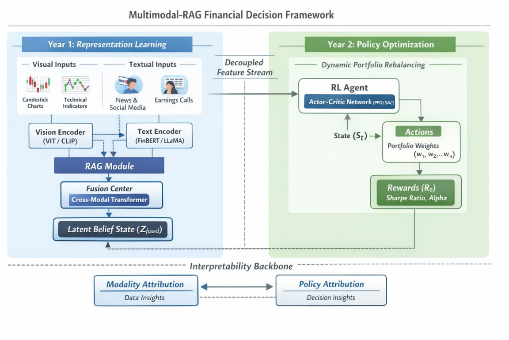

# 115WFAA310699 研究計畫書（CM03）— 繁體中文翻譯版

> **翻譯說明**
> - 譯自 [115WFAA310699_CM03.md](115WFAA310699_CM03.md)（PDF 的 Markdown 轉錄版）；原始依據為 [115WFAA310699_CM03.pdf](115WFAA310699_CM03.pdf)。
> - 本檔僅供閱讀，用詞或語意有疑義時以英文版／PDF 為準。原文本來就是中文的段落（(三) 預期成果等）照錄。
> - 公式、符號、章節編號、表格結構都跟英文版一致；專有名詞第一次出現時括號附英文。
> - 參考文獻保留英文原文。
> - 原文筆誤**沿用英文版的處理**：公式照原樣，以「〔轉錄註 N〕」標示，彙整於文末〈轉錄註記〉。
> - `<!-- p.N -->` 標記原始 PDF 頁碼：標記之後的內容屬於第 N 頁。標記一律放在段落（或整個清單）結束後，跨頁的段落不拆開，整段歸在標記前。

---

<!-- p.1 -->
## 三、研究計畫內容（以中文或英文撰寫）

### (一) 研究計畫之背景

> 請詳述本研究計畫所要探討或解決的問題、研究原創性、重要性、預期影響性及國內外有關本計畫之研究情況、重要參考文獻之評述等。如為連續性計畫應說明上年度研究進度。

### 1. 緒論（Introduction）

金融市場持續產生大量異質且動態演變的資訊。市場參與者必須不斷處理文字新聞報導、分析師評論、法說會逐字稿、結構化財務報表、數值時間序列資料，以及視覺化的技術線圖。整合這些不同模態，是形成一致市場解讀並做出明智投資決策的關鍵。然而，現有的金融人工智慧（AI）系統大多仍是片段化的，只聚焦於單一模態，而非對市場的整體理解。

多模態大型語言模型（multimodal large language models, MLLMs）[1] 近來的進展，展現了在統一表徵空間中整合文字與視覺輸入的卓越能力（例如 GPT-5.2 [2]）。這些模型能綜合跨模態訊號並產生具情境感知的解讀，使其成為金融分析的有力工具。同時，檢索增強生成（retrieval-augmented generation, RAG）[3] 技術被提出，藉由動態納入外部知識來源（如法規申報文件、總體經濟報告與歷史揭露資訊）來強化事實依據（factual grounding）。雖然這些發展大幅提升了多模態資訊綜合的能力，但金融領域的多數應用仍侷限於描述性任務，例如文件摘要、情緒擷取與問答。

多模態理解與序列式金融決策之間仍存在根本性的落差。金融市場本質上是動態系統：決策必須在不確定性下做出，而行動會影響後續的狀態與報酬分布。傳統的金融 AI 方法只處理了這個過程中的特定環節。以文字為基礎的模型如 FinBERT [4] 與 FinancialBERT [5] 被用於新聞與法說會的情緒分析；時間序列模型，包括 LSTM [6-8] 與以 Transformer 為基礎的架構，被用於價格預測；以視覺為基礎的模型如 CNN 與 Vision Transformer（ViT）[9-10] 被用於技術線圖辨識；強化學習（reinforcement learning, RL）方法 [11-14] 也被用於演算法交易與投資組合配置。然而，這些方法通常各自獨立發展，缺乏一個能將多模態感知與有原則的決策最佳化整合起來的統一架構。

<!-- p.2 -->

本研究提出一個以決策為核心（decision-centric）的金融 AI 框架，串接多模態市場理解與序列式策略學習。具體而言，我們將多模態大型語言模型與檢索增強機制概念化為**市場信念建構器（market belief constructors）**。這些元件把異質的金融訊號綜合成結構化的潛在表徵，捕捉市場的語意與情境狀態。在這些信念狀態之上，強化學習代理人學習最佳且風險敏感的策略，用於投資組合配置與金融決策。由於將 RL 置於框架核心，系統得以超越描述性分析，邁向可行動且具適應性的決策支援。

除了決策最佳化之外，透明度與可問責性也是金融應用的關鍵需求。不同於面向消費者的 AI 系統，金融決策模型運作於高風險環境，預測錯誤可能導致重大損失或系統性風險。因此，可解釋性必須超越 token 層級的注意力圖，延伸到決策層級的歸因。本研究整合跨模態歸因分析，以辨識文字訊號、視覺型態與檢索證據如何影響策略輸出。這類可解釋性機制旨在支援法規遵循、風險稽核與機構信任。

因此，本框架沿著三個相互關聯的面向推進金融 AI：

1. 透過整合感知與檢索進行多模態信念建構，
2. 透過在信念狀態上進行強化學習來做序列式決策最佳化，以及
3. 在表徵層級與策略層級兩方面的跨模態可解釋性。

透過在一致的架構中統一感知、推理與決策，本研究期望為下一代具風險意識、可解釋、且可部署於真實市場的金融決策系統奠定基礎。除了投資應用之外，本框架藉由提供更透明可靠的 AI 金融分析，對監管科技（RegTech）、系統性風險監測與普惠金融也具有潛在意義。

### 2. 文獻回顧（Literature Review）

深度學習已廣泛應用於金融預測，特別是用於建模股價與市場指標中的非線性時間相依性。遞迴神經網路（RNN），尤其是長短期記憶（Long Short-Term Memory, LSTM）網路，已成為捕捉金融時間序列序列模式的標準方法。以 LSTM 為基礎的架構藉由有效建模股價變動中的長期相依性與非線性動態，展現出優於傳統統計模型的表現 [15], [16]。

<!-- p.3 -->

許多研究進一步將卷積神經網路（CNN）與 LSTM 模型結合以提升預測效能。在這類混合架構中，CNN 層用於從價格矩陣或技術指標中擷取局部空間特徵，而 LSTM 層則捕捉時間演變 [17], [18]。實證顯示，CNN–LSTM 與 CNN–BiLSTM 模型在股價預測與波動度預測任務中，常常優於單獨的 LSTM 或 CNN 模型 [19]。這些方法凸顯了在金融預測中結合空間特徵擷取與時間建模的重要性。

然而，儘管預測效果良好，多數以 LSTM 與 CNN 為基礎的金融模型主要依賴數值價格資料與技術指標，忽略了可能顯著影響市場行為的文字與情境資訊。

#### 2.1 金融領域中以 Transformer 與視覺為基礎的模型

隨著 Transformer 架構出現，注意力機制越來越多地被應用於金融時間序列分析。以 Transformer 為基礎的模型不需遞迴即可建模長距離相依性，適合捕捉複雜的金融動態 [20], [21]。

同時，Vision Transformer（ViT）架構也在金融情境中被探索，特別是用於處理以圖表呈現的時間序列。藉由將價格序列轉換成類影像的表徵，ViT 模型能捕捉技術線圖中的全域結構型態 [22]。結合 CNN 與 Transformer 模組的混合架構也已被提出，利用 CNN 擷取局部特徵、Transformer 建模全域脈絡，用於股票預測任務 [23]。

雖然這些方法改善了表徵學習，但它們大多仍停留在單一模態框架中——不是數值序列，就是視覺圖表表徵。對於包括文字報告、分析師評論與結構化金融文件在內的異質模態整合，仍相當有限。

#### 2.2 金融決策中的強化學習

在預測之外，強化學習（RL）也被廣泛研究用於金融決策任務，包括投資組合配置、交易策略最佳化與風險管理。早期研究運用深度 Q 網路（Deep Q-Networks, DQN）與策略梯度（policy gradient）方法，直接從歷史價格序列學習交易策略 [24]。後續研究引入了 actor–critic 框架，例如近端策略最佳化（Proximal Policy Optimization, PPO）與非同步優勢 Actor–Critic（Asynchronous Advantage Actor–Critic, A3C），在動態投資組合管理中展現更佳的穩定性與表現 [25], [26]。

<!-- p.4 -->

更進階的模型在 RL 框架中納入圖神經網路，以建模資產間的相關性並改善分散化策略 [27]。這些以 RL 為基礎的方法從靜態預測邁向不確定性下的適應性決策最佳化。

然而，現有的金融 RL 模型通常僅以歷史價格與技術指標來定義狀態空間，很少納入多模態的情境資訊，例如財報、總體經濟訊號、法規揭露或視覺圖表結構。因此，所學到的策略可能無法充分反映真實金融市場在語意與結構上的複雜性。

#### 2.3 金融領域中的大型語言模型

大型語言模型（LLMs）的快速進展大幅重塑了金融自然語言處理的研究。領域調適的模型如 FinBERT [4] 與 FinancialBERT [5] 已被廣泛應用於金融新聞、法說會逐字稿的情緒分析，以及事件驅動的市場解讀任務。這些模型透過納入金融專屬語料與領域詞彙，展現出優於通用語言模型的表現。

近來，以金融資料訓練的大規模基礎模型，如 BloombergGPT [28] 與 FinGPT [29]，進一步擴展了 LLM 在金融領域的應用範圍。這些模型支援文件摘要、金融問答、事件抽取與法規文件解讀等任務。其表現顯示，大規模的領域調適能大幅強化對金融文本的情境理解與事實一致性。

同時，檢索增強生成（RAG）框架被引入，以減輕幻覺並改善以 LLM 為基礎之系統的事實依據 [30]。藉由動態檢索外部金融文件——例如 10-K 申報、總體經濟報告或政策公告——以 RAG 為基礎的模型提升了可靠度與情境完整性。近期針對金融問答設計的多模態 RAG 系統，更進一步展示了將結構化表格、文字揭露與視覺資訊整合進統一答案生成流程的可行性 [31], [32]。

儘管有這些進展，多數以 LLM 為基礎的金融應用仍聚焦於描述性與分析性任務。目前的系統主要設計用於摘要、資訊檢索與以文字為主的推理，而非序列式金融決策。換言之，金融領域中的 LLM 大多扮演進階資訊處理器的角色，而非決策策略的最佳化者。

<!-- p.5 -->

此外，以 LLM 為基礎的系統通常與用於投資組合管理及交易策略最佳化的強化學習框架分開發展 [33]。因此，多模態金融理解與決策策略學習被視為兩個獨立的研究方向，缺乏一個將語意信念建構與序列式最佳化整合起來的統一架構。

這些限制顯示，金融 AI 發展的下一階段不只在於提升語言理解或多模態推理的準確度，而在於將 LLM 產生的多模態表徵轉化為結構化的信念狀態，以支援風險敏感的決策最佳化。

#### 2.4 研究缺口（Research Gap）

現有文獻顯示金融人工智慧在多個研究方向上都有顯著進展。LSTM、CNN 與 Transformer 等深度學習架構提升了金融時間序列建模的預測表現；CNN 與 Vision Transformer（ViT）等視覺模型在從技術線圖擷取結構資訊上展現成效；強化學習方法實現了適應性的投資組合管理與交易策略最佳化；而大型語言模型與檢索增強系統則強化了金融文本理解與文件層級推理。儘管有這些進展，結構性的片段化問題依然存在。

第一，多模態金融表徵學習與序列式決策最佳化大多各自獨立發展。以 MLLM 為基礎的系統主要聚焦於資訊綜合、摘要與問答，而強化學習框架則專注於使用低維度數值狀態（如歷史價格與技術指標）進行行動最佳化。由於缺乏一個有原則的機制，將多模態語意表徵轉化為結構化的決策狀態，限制了感知與策略學習的整合。

第二，現有金融 RL 模型通常以數值時間序列特徵定義狀態空間，忽略了文字揭露、財報、法規申報與視覺圖表結構中蘊含的豐富情境訊號。因此，策略學習常與高層次語意理解脫鉤，可能導致次佳或對情境不敏感的策略。

第三，金融 AI 的可解釋性研究仍侷限於特定模態。雖然 token 層級的歸因方法與 Grad-CAM 視覺化能提供局部解釋，但它們無法自然延伸到序列決策情境中的策略層級決策歸因。在異質多模態輸入下，強化學習策略的可解釋性仍缺乏充分探討。

<!-- p.6 -->

綜合以上觀察，可歸結出一個關鍵缺口：

> **目前尚無一個統一的金融 AI 框架，能在一致的序列決策架構中，整合多模態信念建構、風險敏感的強化學習，以及跨模態的決策層級可解釋性。**

要填補這個缺口，必須重新定位多模態大型語言模型：不把它們當作終端任務的預測器，而是當作產生語意豐富之狀態表徵的信念建構器。接著，這些信念狀態必須連接到能在不確定性與風險限制下最佳化策略的強化學習代理人。此外，在高風險的金融環境中，需要決策層級的歸因機制來確保透明度與法規相容性。

本研究旨在填補此缺口，發展一個以決策為核心的多模態金融框架，將多模態感知、檢索依據、策略最佳化與可解釋性整合進統一架構。

#### 2.5 提出之框架與貢獻

為解決上述研究缺口，本研究提出一個以決策為核心的金融 AI 架構，名為：「**A Multimodal Retrieval-Augmented Financial Decision Framework with Reinforcement Learning**（結合強化學習的多模態檢索增強金融決策框架）」。

本框架的核心創新在於，將多模態信念建構、序列式策略最佳化與跨模態可解釋性整合於單一系統中。

第一，多模態大型語言模型（MLLMs）與檢索增強生成機制被概念化為市場信念建構器。這些元件不作為終端任務預測器，而是將異質的金融訊號——包括文字揭露、技術線圖、數值指標與檢索到的外部文件——綜合成結構化的潛在表徵。這些信念狀態編碼了語意豐富的市場狀況，提供金融環境一個高維度但可解釋的表徵。

第二，引入強化學習（RL）作為決策最佳化層。RL 代理人在多模態信念狀態上運作，學習用於投資組合配置與序列式金融決策的風險敏感策略。此設計串接了感知與行動，使系統能在不確定性下採取適應性策略，而非只產出靜態的分析結果。

第三，本框架在表徵層級與策略層級都納入跨模態可解釋性機制。除了 token 層級與視覺歸因之外，也運用決策層級的歸因技術，量化多模態輸入如何影響策略輸出。這確保了在高風險金融情境中的透明度、可問責性與法規相容性。

<!-- p.7 -->

藉由整合多模態感知、檢索依據、強化學習與決策層級可解釋性，本框架讓金融 AI 從各自孤立的分析模組，進展為能在動態市場環境中運作、一致且以決策為導向的系統。

---

### (二) 研究方法、進行步驟及執行進度

> 請分年列述：1.本計畫採用之研究方法與原因及其創新性。2.預計可能遭遇之困難及解決途徑。3.重要儀器之配合使用情形。4.如為須赴國外或大陸地區研究，請詳述其必要性以及預期效益等。

### 3. 研究方法（Research Methodology）

#### 第一年（First-Year）

本研究提出一個多層次的複合架構，用於將異質金融資料轉化為潛在信念狀態（Latent Belief State），供下游決策使用。有別於傳統聚焦於描述性視覺問答（Visual Question Answering, VQA）的 MLLM 應用，本計畫第一年著重於建構以決策為核心的狀態表徵。為此，我們對視覺輸入（例如 K 線圖、技術指標與財務報表）與文字輸入（例如新聞、分析師報告與公司申報文件）分別使用不同的編碼器。這些訊號被投影到統一的隱藏空間，形成一致的市場脈絡。此外，系統整合了檢索增強生成（RAG）模組，納入來自 SEC 申報文件與總體經濟資料集的外部事實證據，以降低模型幻覺的風險。此階段的主要目標是產生一個壓縮且語意豐富的特徵向量，記為 $Z_{fused}$，作為第二年強化學習（RL）代理人的環境狀態輸入。主要架構如 Figure 1 所示。Phase 1 聚焦於感知與信念建構，產生解耦（decoupled）的潛在狀態（$Z_{fused}$）；Phase 2 則利用此狀態進行以 RL 為基礎的策略最佳化，並搭配統一的可解釋性層。

<!-- p.8 -->

**Figure 1. 提出的兩階段、以決策為核心的多模態金融框架。**

> **〔轉錄註：Figure 1 圖內文字整理〕** 標題「Multimodal-RAG Financial Decision Framework」（多模態 RAG 金融決策框架）。
> - **左側 Year 1: Representation Learning（第一年：表徵學習）**：Visual Inputs 視覺輸入（Candlestick Charts K 線圖、Technical Indicators 技術指標）→ Vision Encoder 視覺編碼器 (ViT / CLIP)；Textual Inputs 文字輸入（News & Social Media 新聞與社群媒體、Earnings Calls 法說會）→ Text Encoder 文字編碼器 (FinBERT / LLaMA)。兩個 encoder（含虛線交叉連線）→ **RAG Module** → **Fusion Center 融合中心 (Cross-Modal Transformer)** → **Latent Belief State 潛在信念狀態 ($Z_{fused}$)**。
> - **中間**：「Decoupled Feature Stream」（解耦特徵流）箭頭，從 Year 1 指向 Year 2 的 RL Agent。
> - **右側 Year 2: Policy Optimization（第二年：策略最佳化）**（Dynamic Portfolio Rebalancing 動態投資組合再平衡）：State ($S_t$) → **RL Agent**（Actor-Critic Network (PPO/SAC)）→ **Actions 行動**（Portfolio Weights 投資組合權重 $(w_1, w_2, \dots, w_n)$）→ **Rewards 報酬 ($R_T$)**（Sharpe Ratio, Alpha）；Rewards 以虛線回饋到左側 Latent Belief State 底部。
> - **底部 Interpretability Backbone（可解釋性骨幹）**：Modality Attribution 模態歸因（Data Insights 資料洞察）⟷ Policy Attribution 策略歸因（Decision Insights 決策洞察）。

首先，訓練資料被組織成 tuple $(X_v, X_t, D, y)$（見 Table 1），其中 $X_v$ 表示圖表或表格影像，$X_t$ 為金融文字查詢，$D$ 為檢索語料庫，$y$ 為目標輸出。每個樣本都設計成同時支援多模態表徵學習與檢索增強生成。舉例來說，一張輸入影像可以是位於 `images/AAPL_Q1_2021.png` 的 K 線圖檔，描述為 *「Apple Inc. 的日 K 線圖，呈現頭肩頂型態且成交量遞減，暗示可能出現空頭反轉。」*

**Table 1. 多模態信念建構的資料組織方式（第一年）**

| 類別 | 內容 |
|---|---|
| **影像資料** ($X_v$) | **檔案路徑：** images/AAPL_Q1_2021.png **描述：** Apple Inc. 的日 K 線圖，呈現「頭肩頂」型態，成交量遞減。 |
| **特徵擷取目標** | 辨識關鍵技術型態、計算視覺訊號信心水準，並擷取趨勢反轉機率。 |
| **檢索脈絡** ($D$) | 1. **技術定義：** 頭肩頂型態搭配成交量遞減，是強烈的空頭反轉指標。 2. **外部連結：** 同期 S&P 500 指數遭遇壓力，顯示系統性的賣壓。 |
| **信念表徵輸出** ($Z_{fused}$) | **[結構化輸出]：** ● **市場情緒：** 偏空（Bearish） ● **關鍵指標：** 量價背離、型態反轉 ● **證據對齊：** SEC 10-Q 報告指出供應鏈受限。*（此輸出會被轉成潛在向量，供第二年的 RL 策略最佳化使用。）* |

<!-- p.9 -->
#### 3.1 視覺編碼器（Vision encoder）

影像資料 $X_v \in \mathbb{R}^{H \times W \times C}$（高 $H$、寬 $W$、通道數 $C$；例如彩色 K 線圖 $C = 3$，灰階掃描表格 $C = 1$）被切成 $T_v$ 個不重疊的 patch，每個大小為 $p \times p$。這些 patch 經攤平與嵌入後，送入視覺編碼器 $g(\cdot)$（例如以金融圖表語料預訓練的 CLIP 或 ViT），產生 token 層級的特徵：

$$
Z_v = g(X_v) \in \mathbb{R}^{T_v \times d_v}
$$

其中 $T_v = \frac{HW}{P^2}$ 為視覺 token 數，$d_v$ 為視覺特徵維度。

為了將這些視覺特徵對齊到語言模型的隱藏空間，我們使用一個可學習的投影矩陣 $P_v \in \mathbb{R}^{T_v \times d_h}$ 〔轉錄註 1〕。投影後的特徵為：

$$
H_v = LN(Z_v P_v) \in \mathbb{R}^{T_v \times d_h}
$$

其中 LN 表示層正規化（Layer Normalization），這是一種藉由對每個特徵向量重新置中與縮放來穩定訓練的標準操作。

在後續的融合階段，這些投影後的 token $H_v$ 被當成類似詞嵌入（word embeddings）的方式處理。若需要整張影像的單一全域表徵，則使用池化（pooling）運算，例如：

<!-- p.10 -->
- [CLS] token 池化：附加一個特殊的「分類 token」來彙整全域脈絡；或
- 平均池化（mean pooling）：對所有 token 嵌入取平均。

此池化後的嵌入記為

$$
h_v = pool(H_v) \in \mathbb{R}^{d_h},
$$

可作為精簡的摘要向量，用於產生檢索鍵（retrieval key）或在解碼器中作為全域條件（global conditioning）等任務。

#### 3.2 文字編碼器（Text encoder）

與視覺編碼並行，每一則金融文字查詢 $X_t$（例如「這張 K 線圖顯示了什麼交易訊號？」或「摘要 Tesla 第二季財報中的主要風險」）被切分成 $T_t$ 個 token 的序列：

$$
X_t = w_1, w_2, \dots, 2_{T_t}.
$$

〔轉錄註 2〕

每個 token $w_i$ 透過預訓練的金融語言模型編碼器 $f(\cdot)$ 映射成嵌入向量，例如 FinBERT、FinancialBERT，或經領域調適的 LLaMA/BLOOM 模型。編碼後的表徵為：

$$
Z_t = f(X_t) \in \mathbb{R}^{T_t \times d_t}
$$

其中 $d_t$ 為文字編碼器的隱藏維度。

為了與多模態融合階段保持一致，這些嵌入會被投影到語言模型使用的同一個隱藏空間維度 $d_h$，透過投影矩陣 $P_t \in \mathbb{R}^{d_t \times d_h}$ 達成：

$$
H_t = LN(Z_t P_t) \in \mathbb{R}^{T_t \times d_h},
$$

其中 $LN$ 同樣表示層正規化。

與視覺路徑類似，若需要文字序列的全域表徵（例如作為檢索鍵），則套用池化運算：

$$
h_t = pool(H_t) \in \mathbb{R}^{d_h}.
$$

此處的池化運算可以是 [CLS] token 的隱藏狀態（BERT 類模型的標準做法），或對所有 token 做平均池化。選擇哪一種，取決於下游任務較適合語意聚焦的（[CLS]）還是均勻分布的（mean）表徵。

<!-- p.11 -->

#### 3.3 檢索增強生成（Retrieval-Augmented Generation）

為了納入外部的領域知識，我們採用檢索增強生成（RAG）模組。檢索語料庫記為 $D = d_1, d_2, \dots, d_{|D|}$，由異質的金融文件組成，例如 SEC 申報文件、分析師報告、新聞文章與總體經濟公報。

給定多模態輸入對 $(H_v, H_t)$，我們將融合後的視覺與文字表徵做池化，建構查詢嵌入 $q \in \mathbb{R}^{d_h}$：

$$
q = pool([h_v; h_t]),
$$

其中 $[h_v; h_t]$ 表示池化後視覺與文字嵌入的串接，$pool(\cdot)$ 可以是線性投影或注意力式池化（attentive pooling）機制。

每份文件 $d_j \in D$ 都預先用相同的文字編碼器 $f(\cdot)$ 加上投影 $P_t$，編碼成稠密向量表徵 $k_j \in \mathbb{R}^{d_h}$。接著在嵌入空間中進行相似度搜尋來檢索：

$$
s_j = sim(q, k_j),
$$

其中 $sim(\cdot,\cdot)$ 通常為餘弦相似度或內積。

依相似度分數選出前 $K$ 份文件：

$$
D_K = d_{j_1}, d_{j_2}, \dots, d_{j_K}, \quad j_l = \arg\max_{j} S_j.
$$

〔轉錄註 3〕

檢索到的文件被重新編碼成 token 嵌入 $H_r \in \mathbb{R}^{T_r \times d_h}$，並與原始輸入串接：

$$
\widetilde{H} = [H_t; H_v; H_r],
$$

作為解碼器生成時的輸入。

此檢索機制確保模型能以事實性、領域特定的金融知識作為預測依據，減少幻覺，並在法說會摘要、市場預測與風險評估等任務中提升可解釋性。

#### 3.4 跨模態融合與解碼器（Cross-Modal Fusion and Decoder）

<!-- p.12 -->
在取得視覺 $H_v$、文字 $H_t$ 與檢索知識 $H_r$ 各自的模態嵌入後，模型進行**跨模態融合（cross-modal fusion）**，將異質的金融訊號整合成統一表徵。

首先沿時間軸串接所有 token 序列：

$$
H_{all} = [H_t; H_v; H_r] \in \mathbb{R}^{(T_t + T_v + T_r) \times d_h},
$$

其中 $[\,;\,]$ 表示序列串接。

接著將此序列送入一個**以 Transformer 為基礎的融合模組** $F(\cdot)$，由多頭自注意力層構成：

$$
Z_{fused} = F([H_t; H_v; H_r]) \in \mathbb{R}^{(T_t + T_v + T_r) \times d_h},
$$

每個注意力頭計算跨模態的成對相依性：

$$
Attention(Q, K, V) = softmax\left(\frac{QK^\top}{\sqrt{d_k}}\right) V,
$$

其中 $Q = H_{all} W_Q,\ K = H_{all} W_k,\ V = H_{all} W_v$，而 $W_Q, W_k, W_v \subset \mathbb{R}^{d_h \times d_h}$ 〔轉錄註 4〕 為可學習的投影矩陣。

所得的融合表徵 $Z_{fused}$ 能捕捉如下的相依關係：

- 圖表型態（$H_v$）與財報敘述說明（$H_t$）之間的相關性
- 檢索到的背景文件（$H_r$）與當前市場新聞之間的對齊。

最後，**解碼器** $D(\cdot)$ 以因果語言模型（causal language model，例如 LLaVA 或經領域調適的 LLaMA-2）實作，以融合表徵為條件，自迴歸地生成輸出 $Y = y_1, y_2, \dots, y_T$：

$$
p(Y \mid H_t, H_v, H_r) = \prod_{i=1}^{T} p\left(y_i \mid y_{<i}, Z_{fused}\right)
$$

此生成過程讓系統能產出**具情境感知的金融敘述**，例如：

- 事件驅動的價格預測（「根據這個 K 線型態與新聞情緒，模型預測短期可能下跌」），
- 風險評估（「檢索到的 SEC 申報文件指出流動性受限，提高了信用風險」），或
- 為機構與散戶投資人量身打造的決策支援輸出。

<!-- p.13 -->

#### 3.5 訓練流程與信念狀態最佳化（Training Process and Belief State Optimization）

第一年架構的訓練重點，在於最佳化模型將多模態訊號綜合成可靠潛在信念狀態（$Z_{fused}$）的能力。為了在單台高效能工作站（例如 RTX 5090）上確保運算效率，我們採用透過 QLoRA 的參數高效微調（Parameter-Efficient Fine-Tuning, PEFT），凍結骨幹 MLLM，只更新投影層與特定的注意力 adapter。每個訓練樣本由以下 tuple 組成：

$$
\left(x_v, x_t, D_r, y_{belief}\right),
$$

其中 $x_v$ 表示圖表或表格影像，$x_t$ 表示文字查詢（例如市場新聞、分析師評論），$D_r = d_1, \dots, d_K$ 代表前 $K$ 份檢索文件，$y$ 為真實（ground-truth）目標序列（例如預測說明或結構化報告）。

##### (1) 多模態對齊損失（Multimodal Alignment Loss, $L_{align}$）

各模態的嵌入都被投影到解碼器的共享空間。為確保跨模態一致性，我們在影像嵌入 $H_v$ 與其配對的文字嵌入 $H_t$ 之間施加對比式對齊損失：

$$
L_{align} = -\log \frac{\exp\left(\langle H_v H_t \rangle / \tau\right)}{\sum_{t'} \exp\left(\langle H_v H_{t'} \rangle / \tau\right)}
$$

其中 $\tau$ 為溫度參數。此目標確保潛在信念狀態能準確反映技術線圖型態與金融新聞之間的關聯。

##### (2) 證據依據損失（Evidence Grounding Loss, $L_{ground}$）

為了防止模型忽略 RAG 檢索到的文件或產生幻覺，我們施加 grounding 損失。它以模型的 cross-attention 權重 $\hat{\alpha}$ 與檢索段落的 oracle 相關性分數 $\alpha^*$ 之間的 KL 散度為基礎：

<!-- p.14 -->
$$
L_{ground} = \sum_{i=1}^{K} \alpha_i^* \log \frac{\alpha_i^*}{\hat{\alpha}_i}.
$$

這確保模型把較高的歸因分配給真正相關的金融文件。

##### (3) 信念一致性損失（Belief Consistency Loss, $L_{belief}$）

為確保潛在表徵 $Z_{fused}$ 不只捕捉語言句法，也捕捉決策所需的鑑別性金融特徵，我們將真實目標 $y_{belief}$ 定義為一個複合序列，同時包含結構化狀態 token（例如 `[BULLISH]`、`[HIGH_VOLATILITY]`）與敘述性說明。

$$
L_{belief} = -\sum_{t=1}^{T_y} \log p_\theta\left(y_{belief,t} \mid y_{belief<t}, Z_{fused}\right)
$$

其中：

- $y_{belief}$ 在序列開頭插入特殊的分類 token（例如 `<TREND>`、`<RISK_LEVEL>`）。
- $T_y$ 為目標序列長度。

意義：藉由強迫模型在文字之外同時預測結構化指標，此目標迫使潛在狀態 $Z_{fused}$ 編碼高層次的語意概念（例如從圖表辨識出「反轉型態」），而不只是記住表面的文字統計。這確保 $Z_{fused}$ 能作為 Phase 2 中 RL 代理人穩健且富含資訊的狀態空間。

##### (4) Phase 1 的複合目標（Composite Objective for Phase 1）

第一年的最終聯合損失為：

$$
L = \lambda_1 L_{align} + \lambda_2 L_{ground} + \lambda_3 L_{belief},
$$

其中 $\lambda_3$ 被優先加重，以確保信念狀態的豐富度；$\lambda_1$ 與 $\lambda_2$ 則作為結構性限制，用來對齊多模態訊號與檢索訊號。

#### 第二年（Second-Year）

#### 3.6 以 RL 為基礎的策略最佳化與統一可解釋性（RL-based Policy Optimization and Unified Interpretability）

第二年的研究重點從多模態感知轉向**策略性決策最佳化**。我們把 Phase 1 產生的**潛在信念狀態（\$\$）**〔轉錄註 5〕當作環境狀態，用來訓練強化學習（RL）代理人。此階段的目標是發展一個不只能獲利、還具備風險意識且可解釋的策略。

<!-- p.15 -->

##### (1) 投資組合管理的 MDP 建模（MDP Formulation for Portfolio Management）

我們將動態投資組合管理問題建模為馬可夫決策過程（Markov Decision Process, MDP），以 tuple $(\mathcal{S}, \mathcal{A}, \mathcal{P}, \mathcal{R}, \gamma)$ 定義：

- **狀態空間（$\mathcal{S}$）：** 時間 $t$ 的狀態定義為 $s_t = [Z_{fused,t}, h_{t-1}]$，其中 $Z_{fused,t}$ 是 Phase 1 從 MLLM 擷取出的潛在信念向量，$h_{t-1}$ 代表代理人目前的投資組合持倉。這種解耦設計讓 RL 代理人能利用高層次的語意洞察，而不必承擔直接處理原始多模態資料的運算負擔。
- **行動空間（$\mathcal{A}$）：** 行動 $a_t \in \mathbb{R}^N$ 對應 $N$ 檔資產的目標投資組合權重向量，受限於 $\sum_{i=1}^{N} |a_{i,t}| = 1$（假設資金全數投入，且在允許的情況下可放空）。
- **轉移動態（$\mathcal{P}$）：** 環境依真實市場資料的動態演變，$s_{t+1} \sim \mathcal{P}(s_{t+1} \mid s_t, a_t)$。

〔轉錄註 6〕

##### (2) 透過近端策略最佳化（PPO）進行策略最佳化

為了在充滿雜訊的金融環境中確保穩定收斂，我們採用**近端策略最佳化（Proximal Policy Optimization, PPO）**演算法。PPO 最佳化一個經截斷（clipped）的替代目標函數，以避免破壞性的策略更新：

$$
\mathcal{L}_{CLIP}(\theta) = \hat{\mathbb{E}}_t\left[\min\left(r_t(\theta)\hat{A}_t,\ \text{clip}\left(r_t(\theta), 1-\epsilon, 1+\epsilon\right)\hat{A}_t\right)\right]
$$

其中：

- $\theta$ 表示策略參數。
- $r_t(\theta) = \dfrac{\pi_\theta(a_t \mid s_t)}{\pi_{\theta_{old}}(a_t \mid s_t)}$ 為新舊策略之間的機率比。
- $\hat{A}_t$ 為估計的優勢函數（advantage function）。
- $\epsilon$ 為限制更新步幅的超參數。

##### (3) 風險敏感的報酬塑形（Risk-Sensitive Reward Shaping, $\mathcal{R}$）

不同於一般最大化原始累積報酬的 RL 應用，金融決策需要嚴格的風險控制。我們提出一個複合的**風險敏感報酬函數**：

<!-- p.16 -->
$$
\mathcal{R}_t = \mu(R_p) - \lambda_1 \cdot \sigma(R_p) - \lambda_2 \cdot \mathrm{MDD}_t - \eta \cdot \mathrm{TC}_t
$$

其中：

- $\mu(R_p)$ 與 $\sigma(R_p)$ 分別代表投資組合的預期報酬與波動度。
- $\mathrm{MDD}_t$（**最大回撤，Maximum Drawdown**）：懲罰從權益高點產生不可接受虧損的策略。
- $\mathrm{TC}_t$（**交易成本，Transaction Costs**）：考量交易摩擦，避免代理人過度頻繁換手（over-trading）。

##### (4) 統一可解釋性：策略的整合梯度（Unified Explainability: Integrated Gradients for Policy）

〔轉錄註 7〕

為了把 RL 代理人的決策歸因回原始的多模態輸入，我們實作**整合梯度（Integrated Gradients, IG）**。此方法滿足完備性公理（axiom of completeness），確保歸因分數的總和等於模型輸出相對於基準點的差值。輸入 $x$（即 $Z_{fused}$ 的各分量）第 $i$ 個特徵的歸因計算如下：

$$
\text{Attribution}_i(x) = (x_i - x_i') \times \int_{\alpha=0}^{1} \frac{\partial \pi\left(a_t \mid x' + \alpha(x - x')\right)}{\partial x_i}\, d\alpha
$$

其中 $x'$ 為基準參考點（例如零向量）。此機制讓我們能量化各模態——不論是特定的視覺圖表型態或某份檢索到的 SEC 申報文件——對最終投資組合再平衡決策的邊際貢獻，從而確保法規透明度。

### 4. 預期困難與可能解決方案（Anticipated Challenges and Potential Solutions）

實作一個整合 MLLM、RAG 與強化學習（RL）的多模態金融 AI 系統，面臨重大的技術挑戰。我們辨識出四項主要風險，並擬定具體的因應策略以確保計畫可行性，特別是在單節點高效能運算資源的限制下。主要挑戰與可能解決方案如 Table 2 所示。

<!-- p.17 -->
**Table 2.**〔原文表格無標題，依內文稱 table 2〕

| 預期挑戰 | 提出的解決方案與因應策略 |
|---|---|
| **1. 運算資源限制（硬體限制）**  訓練或微調大型多模態模型（例如 LLaVA、Llama-3-Vision）通常需要多 GPU 叢集。在單台工作站（例如 RTX 5090）上同時執行 MLLM 推論與 RL 模擬，有 **GPU 記憶體耗盡（OOM）** 的風險。 | **(1) 參數高效微調（PEFT）：** 不做全參數微調，而是採用 **QLoRA（Quantized Low-Rank Adaptation，量化低秩調適）**，凍結骨幹模型，只更新少量 adapter 權重。可減少最多 60% 的 VRAM 用量。  **(2) 解耦架構：** 如研究方法所設計，我們把**感知（第一年）**與**決策（第二年）**解耦。笨重的 MLLM 以離線方式預先計算潛在信念狀態（$Z_{fused}$），線上的 RL 代理人則在這些輕量向量上訓練，確保運算效率。 |
| **2. 雜訊環境中 RL 收斂不穩定**  金融市場的訊雜比很低。直接把高維度多模態輸入映射到交易行動，常導致**無法收斂**，或學到平凡的策略（例如永遠持有現金）。 | **(1) 凍結信念狀態預訓練：** 使用第一年凍結的 $Z_{fused}$，降低 RL 代理人狀態空間的維度，穩定學習過程。  **(2) 課程學習（Curriculum Learning）：** 實施課程學習策略，先讓 RL 代理人在簡化的市場環境（例如低波動期間）中學習，再逐步引入複雜情境（例如市場崩盤）以提升穩健性。  **(3) PPO 截斷：** 使用 **PPO（近端策略最佳化）** 確保策略更新有界，避免訓練過程中的災難性遺忘。 |
| **3. RAG 幻覺與不相關檢索**  RAG 模組可能檢索到不相關的文件（雜訊）或過時的金融新聞，導致 MLLM 產生「幻覺」的市場信念，誤導 RL 代理人。 | **(1) 混合搜尋與重新排序：** 結合關鍵字搜尋（BM25）與語意稠密檢索，再以 Cross-Encoder Re-ranker 過濾不相關文件，然後才送入 MLLM。  **(2) Grounding 損失：** 如 3.5 節所定義，證據依據損失（$\mathcal{L}_{ground}$）會在模型關注到與 oracle 相關性標籤不符的檢索片段時明確給予懲罰，強化事實一致性。 |
| **4. 跨模態可解釋性的困難**  要解釋 RL 代理人為何根據一個「融合潛在向量」做出決策是很抽象的。傳統 Grad-CAM 只適用於視覺，無法說明投資組合再平衡背後的文字或檢索邏輯。 | **(1) 整合梯度（IG）：** 在 Phase 2 對策略網路套用 IG，把歸因分數計算回信念狀態（$Z_{fused}$）的特定維度。  **(2) 階層式解釋：** 把 $Z_{fused}$ 中高歸因的維度追溯回原始輸入（例如「第 54 維是被視覺編碼器中的『頭肩頂』型態觸發的」）。如此建立一條從原始資料到最終交易的透明推理鏈。 |

<!-- p.18：表格第 3、4 列位於此頁 -->

---

<!-- p.19 -->
### (三) 預期完成之工作項目及成果

> 請分年列述：1.預期完成之工作項目。2.對於參與之工作人員，預期可獲之訓練。3.預期完成之研究成果（如實務應用績效、期刊論文、研討會論文、專書、技術報告、專利或技術移轉等質與量之預期成果）。4.學術研究、國家發展及其他應用方面預期之貢獻。

本計畫旨在構建一套具備「決策層級解釋性」的多模態金融強化學習系統。透過兩年期的分階段執行，我們預期在技術研發、人才培育與學術貢獻上達成以下具體目標：

#### 1. 預期完成之工作項目

**第一年：多模態感知與潛在信念表徵建構 (Perception & Belief Construction)**

本年度重點在於解決異質金融數據的對齊與事實基礎（Grounding）問題，產出可供決策使用的潛在信念狀態（Latent Belief State, $Z_{fused}$）。

- **數據工程與清洗：** 建立涵蓋 K 線圖、財報表格（視覺模態）與新聞、分析師報告（文字模態）的對齊資料集。
- **檢索增強（RAG）模組開發：** 部署向量資料庫（如 Milvus），索引 SEC Filings 與總經報告，並實作基於語義檢索的證據提取機制。
- **信念建構模型訓練：** 採用參數高效微調（PEFT/QLoRA）技術，在單機（RTX 5090）環境下訓練多模態編碼器與投影層，優化對比損失（Contrastive Loss）與證據一致性損失（Grounding Loss）。
- **表徵效能驗證：** 針對 $Z_{fused}$ 進行診斷性分類測試（Diagnostic Classification），驗證其在市場情緒分類與事件抽取上的準確度。

**第二年：強化學習決策優化與統一解釋性 (Decision & Transparency)**

本年度重點在於利用第一年的信念表徵訓練決策代理人，並建立全鏈路的解釋機制。

- **RL 環境構建：** 設計基於 $Z_{fused}$ 的馬可夫決策過程（MDP），定義風險敏感（Risk-Sensitive）的獎勵函數。
- **策略網路訓練：** 使用 PPO 演算法訓練投資組合管理代理人，並導入課程學習（Curriculum Learning）以提升模型在極端行情下的穩健性。
- **跨模態歸因分析：** 開發整合梯度（Integrated Gradients）模組，計算不同模態（圖、文、檢索證據）對最終交易動作（Action）的貢獻度。
- **系統整合與回測：** 完成全系統整合，並進行嚴謹的歷史回測（Backtesting），比較夏普比率（Sharpe Ratio）與最大回撤（MDD）等績效指標。

<!-- p.20 -->
**整體執行計畫甘特圖如下圖所示：**

圖表說明：

- **Q1-Q4：** 代表每年的四個季度（1-3 月, 4-6 月, 7-9 月, 10-12 月）。
- **深色區塊 (█)：** 代表該任務的主要執行與高強度工作期間。
- **淺色區塊 (░)：** 代表準備階段、收尾或持續性的維護工作。
- **關鍵相依性 (→)：** 注意 Task 1.3/1.4 結束後，Task 2.1 才開始高強度運作，體現了兩年期的銜接。

> 〔轉錄註〕原文甘特圖為表格，以下依 PDF 截圖逐格轉錄（每格 4 個字元 = 一季，左半格 = 季初、右半格 = 季末）。

| 分年 | 工作項目 (Task Description) | Y1 Q1 | Y1 Q2 | Y1 Q3 | Y1 Q4 | Y2 Q1 | Y2 Q2 | Y2 Q3 | Y2 Q4 |
|---|---|---|---|---|---|---|---|---|---|
| | *Year 1（第一年）感知與信念建構 (Phase 1)* → *Year 2 第二年：決策優化與解釋性 (Phase 2)* | | | | | | | | |
| 1.1 | 多模態數據蒐集、清洗與對齊 (Data Pipeline) | ████ | ██░░ | ░░░░ | | | | | |
| 1.2 | RAG 向量資料庫建置與檢索優化 (RAG Setup) | ░░██ | ████ | ██░░ | | | | | |
| 1.3 | MLLM 信念編碼器訓練 (PEFT/QLoRA) | | ░░██ | ████ | ██░░ | | | | |
| 1.4 | 潛在表徵 (Zfused) 效能驗證與診斷 | | | ░░██ | ████ | ░░░░ | | | |
| 2.1 | RL 環境構建與獎勵函數設計 (MDP Setup) | | | | ░░░░ | ████ | ██░░ | | |
| 2.2 | 強化學習策略代理人訓練 (PPO Agent Training) | | | | | ░░██ | ████ | ██░░ | |
| 2.3 | 跨模態歸因解釋模組開發 (Integrated Gradients) | | | | | | ░░██ | ████ | ██░░ |
| 2.4 | 全系統整合、歷史回測與績效評估 (System Test) | | | | | | | ░░██ | ████ |
| III. | 計畫管理與成果發表 (General) | | | | | | | | |
| 3.1 | 定期進度會議與產學交流 | ░░░░ | ░░░░ | ░░░░ | ░░░░ | ░░░░ | ░░░░ | ░░░░ | ░░░░ |
| 3.2 | 論文撰寫、投稿與期末報告彙整 | | ░░░░ | ░░██ | ████ | | ░░░░ | ░░██ | ████ |

<!-- p.21 -->
#### 2. 對於參與之工作人員，預期可獲之訓練

本計畫涉及深度學習、自然語言處理與計量金融的交叉領域，參與之研究生與研究助理將獲得以下關鍵技能訓練：

- **大型模型微調與優化技術：** 學習 LoRA/QLoRA 等高效率訓練技術，以及 Transformer 架構的底層實作能力。
- **檢索增強生成 (RAG) 實務：** 掌握向量資料庫建置、語義搜尋優化及處理長文本（Long-context）金融文獻的實務經驗。
- **強化學習 (RL) 與金融工程：** 深入理解 PPO/SAC 等演算法原理，並學習如何將金融風險指標轉化為數學上的獎勵函數（Reward Shaping）。
- **跨領域溝通與學術寫作：** 培養將 AI 技術應用於金融場景的轉譯能力，並訓練撰寫高品質國際會議論文與技術報告。

#### 3. 預期完成之研究成果

**質化成果：**

- **原創性架構：** 提出首個將 MLLM 視為「信念構造者（Belief Constructor）」並結合 RL 進行序列決策的金融 AI 框架。
- **可解釋性突破：** 建立一套能從「決策結果」回推至「視覺/文本證據」的歸因機制，解決傳統金融黑盒子的信任問題。

**量化成果 (KPI)：**

- **學術論文：** 預計發表 **1-2 篇** 高影響力國際期刊（如 IEEE TNNLS, Expert Systems with Applications 或 Finance 領域頂刊）或 **1-2 篇** 頂尖國際研討會論文（如 AAAI, IJCAI, ICAIF）。
- **技術報告：** 完成年度計畫結案報告 2 份，詳細記錄模型架構、實驗參數與回測數據。

#### 4. 學術研究、國家發展及其他應用方面預期之貢獻

<!-- p.22 -->
**學術研究貢獻：**

- **建立多模態金融 RL 基準 (Benchmark)：** 本計畫提出的評估指標與資料處理流程，將為後續研究提供標準化的比較基準。
- **深化 MLLM 在決策領域的應用：** 證實 MLLM 不僅能用於生成文字，更能作為高維度狀態空間的壓縮器，拓展了 Generative AI 在控制領域的應用邊界。

**國家發展與產業應用貢獻：**

- **推動 RegTech (監管科技) 發展：** 本計畫開發的解釋性模組可應用於金融監理，協助主管機關自動化審查演算法交易的邏輯合規性，降低系統性風險。
- **提升金融科技競爭力：** 透過訓練具備「避險意識」的 AI 代理人，可協助國內投信投顧業者開發新一代的智能理財（Robo-Advisor）系統，提升資產管理效率。
- **培育 AI + Finance 雙語人才：** 透過本計畫培育的跨領域人才，將成為台灣發展 AI 金融科技產業的中堅力量，填補目前產業界對高階 AI 金融工程師的迫切需求。

---

## 參考文獻（Reference）

1. Xu, Z., Chen, Z., Zhang, Y., Song, Y., Wan, X., & Li, G. (2023). Bridging vision and language encoders: Parameter-efficient tuning for referring image segmentation. In *Proceedings of the IEEE/CVF International Conference on Computer Vision* (pp. 17503-17512).
2. OpenAI. (2025). GPT-5.2 [Large language model]. https://openai.com/index/introducing-gpt-5-2/
3. Lewis, P., Perez, E., Piktus, A., Petroni, F., Karpukhin, V., Goyal, N., ... & Kiela, D. (2020). Retrieval-augmented generation for knowledge-intensive nlp tasks. *Advances in neural information processing systems*, 33, 9459-9474.
4. Huang, A. H., Wang, H., & Yang, Y. (2023). FinBERT: A large language model for extracting information from financial text. *Contemporary Accounting Research*, 40(2), 806-841.
5. Hazourli, A. (2022). Financialbert-a pretrained language model for financial text mining. *Research Gate*, 2.
6. Mehtab, S., & Sen, J. (2020, November). Stock price prediction using CNN and LSTM-based deep learning models. In *2020 International Conference on Decision Aid Sciences and Application (DASA)* (pp. 447-453). IEEE.
<!-- p.23 -->
7. Seun, E., & Olawunmi Asake, A. (2024). Stock Price Prediction: Evaluating The Efficacy Of CNN, LSTM, CNN-LSTM, and CNN-BILSTM Models. *International Journal of Computing and Digital Systems*, 16(1), 1-10.
8. Joshi, S., Mahanthi, B. L., Pokkuluri, K. S., Ninawe, S. S., & Sahu, R. (2025). Integrating LSTM and CNN for Stock Market Prediction: A Dynamic Machine Learning Approach. *Journal of Artificial Intelligence and Technology*, 5, 168-179.
9. Wooh, M., & Cho, P. (2025). Integrating Vision Transformer and Time–Frequency Analysis for Stock Volatility Prediction. *Mathematics*, 13(23), 3787.
10. Li, Y., Wang, X., & Guo, Y. (2024). CNN-Trans-SPP: A small Transformer with CNN for stock price prediction. *Electronic Research Archive*, 32(12).
11. Charkhestani, A., & Esfahanipour, A. Behaviorally informed deep reinforcement learning for portfolio optimization with loss aversion and overconfidence. *Scientific reports*.
12. He, J., Hua, C., Zhou, C., & Zheng, Z. (2025). Reinforcement-Learning Portfolio Allocation with Dynamic Embedding of Market Information. *arXiv preprint arXiv:2501.17992*.
13. Niu, H., Li, S., & Li, J. (2022, October). MetaTrader: An reinforcement learning approach integrating diverse policies for portfolio optimization. In *Proceedings of the 31st ACM international conference on information & knowledge management* (pp. 1573-1583).
14. Pawar, A. A., Muskawar, V. P., & Tiku, R. (2024). Portfolio Management using Deep Reinforcement Learning. *arXiv preprint arXiv:2405.01604*.
15. Fischer, T., & Krauss, C. (2018). Deep learning with long short-term memory networks for financial market predictions. *European journal of operational research*, 270(2), 654-669.
16. Bao, W., Cao, Y., Yang, Y., Che, H., Huang, J., & Wen, S. (2025). Data-driven stock forecasting models based on neural networks: A review. *Information Fusion*, 113, 102616.
17. Zeng, Z., Kaur, R., Siddagangappa, S., Rahimi, S., Balch, T., & Veloso, M. (2023). Financial time series forecasting using cnn and transformer. *arXiv preprint arXiv:2304.04912*.
18. Cheng, Y., Xu, Z., Chen, Y., Wang, Y., Lin, Z., & Liu, J. (2025, July). A deep learning framework integrating CNN and BiLSTM for financial systemic risk analysis and prediction. In *Proceedings of the 2025 International Conference on Economic Management and Big Data Application* (pp. 270-274).
19. Xiao, J., Deng, T., & Bi, S. (2024, August). Comparative analysis of LSTM, GRU, and transformer models for stock price prediction. In *proceedings of the international conference on digital economy, blockchain and artificial intelligence* (pp. 103-108).
20. Lezmi, E., & Xu, J. (2023). Time series forecasting with transformer models and application to asset management. *Available at SSRN 4375798*.
21. Li, S., Schulwol, Z. B., & Miikkulainen, R. (2025). Transformer Based Time-Series Forecasting for Stock. *arXiv preprint arXiv:2502.09625*.
22. Wooh, M., & Cho, P. (2025). Integrating Vision Transformer and Time–Frequency Analysis for Stock Volatility Prediction. *Mathematics*, 13(23), 3787. 〔轉錄註 9〕
<!-- p.24 -->
23. Kabir, M. R., Bhadra, D., Ridoy, M., & Milanova, M. (2025). LSTM–transformer-based robust hybrid deep learning model for financial time series forecasting. *Sci*, 7(1), 7.
24. Jiang, Z., Xu, D., & Liang, J. (2017). A deep reinforcement learning framework for the financial portfolio management problem. *arXiv preprint arXiv:1706.10059*.
25. Wang, J., Hai, M., & Li, H. (2024). A Deep Reinforcement Learning Model for Portfolio Management based on Weight Adjustment. *Procedia Computer Science*, 242, 356-363.
26. Yu, J., & Chang, K. C. (2025). Smart Tangency Portfolio: Deep Reinforcement Learning for Dynamic Rebalancing and Risk–Return Trade-Off. *International Journal of Financial Studies*, 13(4), 227.
27. Soleymani, F., & Paquet, E. (2021). Deep graph convolutional reinforcement learning for financial portfolio management–DeepPocket. *Expert Systems with Applications*, 182, 115127.
28. Wu, S., Irsoy, O., Lu, S., Dabravolski, V., Dredze, M., Gehrmann, S., ... & Mann, G. (2023). Bloomberggpt: A large language model for finance. *arXiv preprint arXiv:2303.17564*.
29. Liu, X. Y., Wang, G., Yang, H., & Zha, D. (2023). Fingpt: Democratizing internet-scale data for financial large language models. *arXiv preprint arXiv:2307.10485*.
30. Gao, Y., Xiong, Y., Gao, X., Jia, K., Pan, J., Bi, Y., ... & Wang, H. (2023). Retrieval-augmented generation for large language models: A survey. *arXiv preprint arXiv:2312.10997*, 2(1).
31. Gondhalekar, C., Patel, U., & Yeh, F. C. (2025). MultiFinRAG: An Optimized Multimodal Retrieval-Augmented Generation (RAG) Framework for Financial Question Answering. *arXiv preprint arXiv:2506.20821*.
32. Zhao, S., Jin, Z., Li, S., & Gao, J. (2025). FinRAGBench-V: A Benchmark for Multimodal RAG with Visual Citation in the Financial Domain. *arXiv preprint arXiv:2505.17471*.
33. Unnikrishnan, A. (2024). Financial news-driven llm reinforcement learning for portfolio management. *arXiv preprint arXiv:2411.11059*.

---

## 轉錄註記

以下為原文中的筆誤或排版殘留，與英文版相同。正文**保留原樣**未修改；「應為」只是依上下文的合理推斷，非計畫書官方修正。

| # | 位置 | 原文 | 推斷應為／說明 |
|---|---|---|---|
| 1 | §3.1 投影矩陣 | $P_v \in \mathbb{R}^{T_v \times d_h}$ | $P_v \in \mathbb{R}^{d_v \times d_h}$（$Z_v P_v$ 要能相乘；對照 §3.2 的 $P_t \in \mathbb{R}^{d_t \times d_h}$） |
| 1b | §3.1 | $T_v = HW/P^2$，patch 寫 $p \times p$ | 大小寫不一致，應為 $HW/p^2$ |
| 1c | §3.1 | 英文原文 "$C = 1$ or grayscale scanned tables" | 應為 "for grayscale"；中譯已依正確語意翻成「灰階掃描表格 $C = 1$」 |
| 2 | §3.2 tokenization | $X_t = w_1, w_2, \dots, 2_{T_t}$ | $X_t = w_1, w_2, \dots, w_{T_t}$ |
| 3 | §3.3 Top-K | $j_l = \arg\max_j S_j$（大寫 $S$） | 前文相似度為小寫 $s_j$；且 top-K 應為「取前 K 大」而非單一 argmax |
| 4 | §3.4 | $W_Q, W_k, W_v \subset \mathbb{R}^{d_h \times d_h}$ | $\in$；下標大小寫（$W_Q$ vs $W_k$）亦不一致 |
| — | §3.5 | tuple 用 $y_{belief}$，說明文字寫「$y$ 為真實目標序列」 | 指同一個目標序列 |
| — | §3.5 $L_{align}$ | $\langle H_v H_t \rangle$ | 內積一般寫 $\langle h_v, h_t \rangle$（且應為 pooled 向量） |
| 5 | §3.6 開頭 | 「潛在信念狀態（\$\$）」 | LaTeX 殘留，應為 $(Z_{fused})$ |
| 6 | §3.6 (1)(3) | PDF 中出現 `$t$`、`$N$`、`($\mathcal{R}$)` 未渲染的 LaTeX 原始碼 | 本檔已直接以公式呈現 |
| — | §3.6 (1) | MDP tuple 有 $\mathcal{R}, \gamma$ | 原文只列出 $\mathcal{S}, \mathcal{A}, \mathcal{P}$ 三項說明，$\mathcal{R}$ 見 (3)，$\gamma$ 未說明 |
| 7 | §3.6 (4) | 原文 "(4) Unified Explainability…" 標題緊接在 TC 項目後同一行 | 本檔拆為獨立小節標題 |
| — | Figure 1 | Rewards 標示為 $R_T$ | 正文 reward 為 $\mathcal{R}_t$ |
| 9 | Reference [22] | 與 [9] 完全相同 | 重複文獻 |
